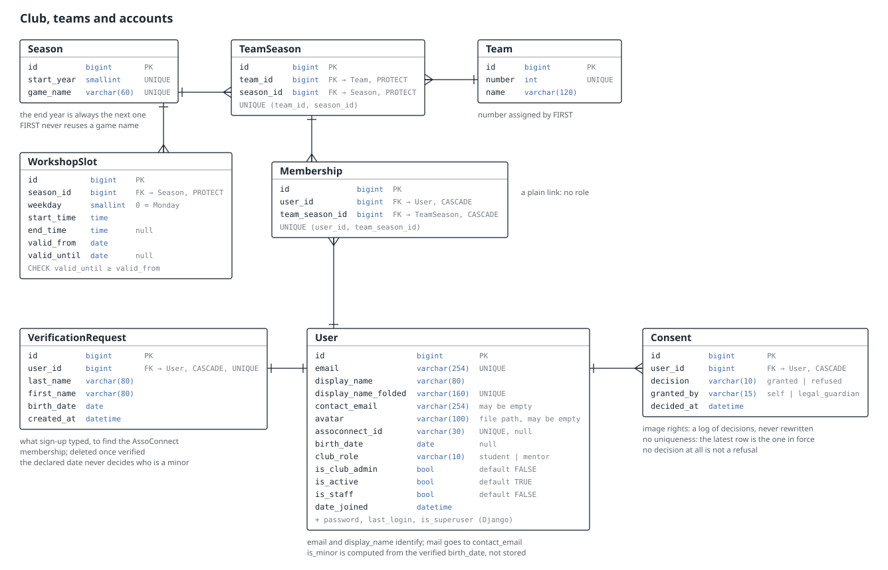
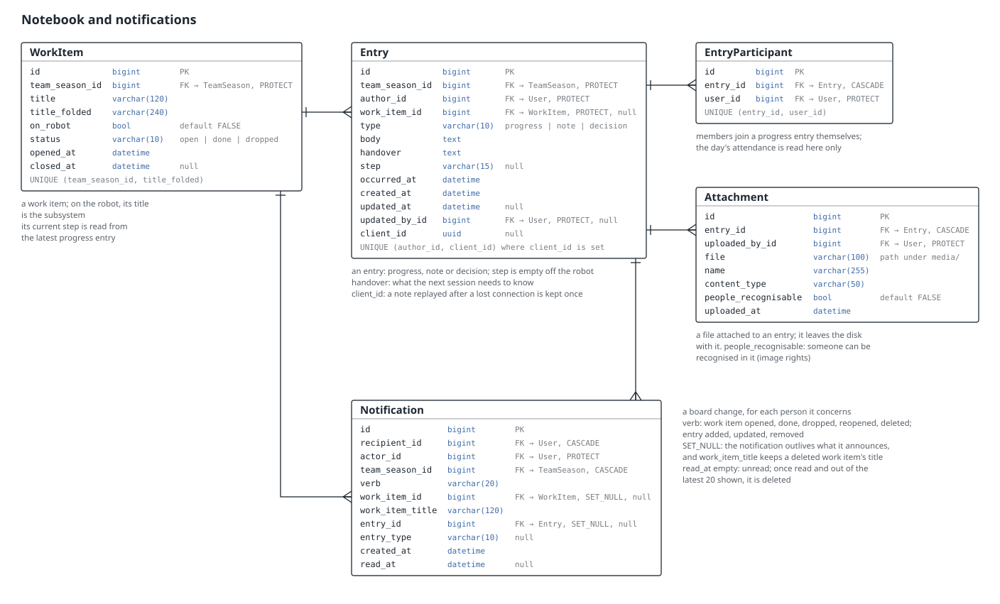
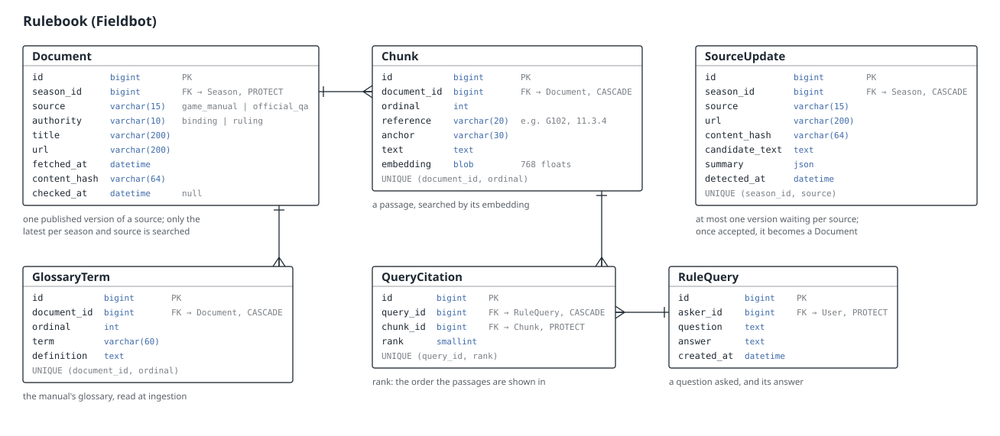
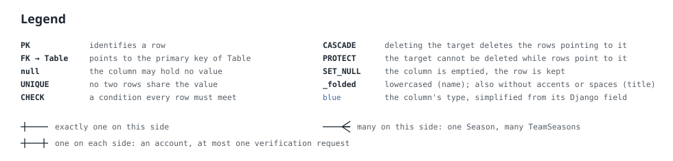

*This project has been created as part of the 42 curriculum by jbarthel, qbourine, qrios, epesnel.*

# transcendence

## Description

**Fieldnotes** is a private web application for a FIRST Tech Challenge
robotics club: teams, members and the engineering notebook.
*ft_transcendence*, 42 common core.

It is separate from the club's own public website. It records the teams'
real work — work items, progress, notes and decisions — throughout the
season, so that record can later be cited in the engineering portfolio
instead of reconstructed from memory once the season is over. One
deployment serves one club, locally.

Key features:

- A live work-item board per team, updated over a WebSocket the moment
  anyone writes to it ([module 6](#modules-and-points)).
- Interactive activity charts, with CSV export and custom date ranges
  ([module 7](#modules-and-points)).
- A rulebook assistant that answers questions from the game manual and the
  official Q&A, citing the passages it relies on
  ([module 8](#rulebook-questions)).
- File attachments on any trace, with client and server validation
  ([module 9](#attachments)).
- Data export and deletion, both confirmed by e-mail
  ([module 10](#data-export-and-deletion)).
- An installable, offline-capable progressive web app.
- A full notification system for everything that changes on the board.
- Filtered, sorted, paginated search across the whole notebook
  ([Notebook search](#notebook-search)).
- An in-house [design system](#design-system) of ten-plus components.
- Profile editing, an avatar and teammates' online status.
- French, English and Spanish, switchable at any time.
- Support for Chrome, Firefox and Safari.

The code is English, the interface is French: model, field and function
names, comments and docstrings are English. Django keeps French labels for
its own administration interface; user-facing application text belongs to
the frontend translation catalogue.

## Team and roles

Four people, each with a 42 login and a GitHub account that doesn't
resemble it — recorded here once, so that a commit is never attributed to
the wrong person. The rest of this document names everyone by their 42
login; the GitHub account below is what actually appears in `git log`,
commits and pull requests.

| Role(s) | 42 login | GitHub account |
|---|---|---|
| Product Owner, Developer | jbarthel | [`JeromeBarthelemy`](https://github.com/JeromeBarthelemy) |
| Project Manager / Scrum Master, Developer | qbourine | [`quentinbourinet-max`](https://github.com/quentinbourinet-max) |
| Technical Lead / Architect, Developer | qrios | [`Nitwee`](https://github.com/Nitwee) |
| Developer | epesnel | [`Enelsep`](https://github.com/Enelsep) |

- **Product Owner** — wrote the concept note (`docs/fieldnotes.html`), froze
  the vocabulary (`docs/lexique.md`), and decides which of the subject's
  modules the club claims (`docs/modules.md`).
- **Project Manager / Scrum Master** — runs the GitHub Projects board,
  triages and assigns issues, reviews and merges pull requests, resolves
  conflicts against `main`, and assembled this README (#6).
- **Technical Lead / Architect** — reviews pull requests for correctness and
  architectural fit; see [Individual contributions](#individual-contributions)
  for which ones.
- **Developer** — all four build features inside that architecture, on top
  of their other role; see [Features per contributor](#features-per-contributor)
  for what each one actually shipped.

## Project management

Work is tracked as GitHub issues, one per unit of work, each scoped to a
milestone — the milestone *is* the subject's module (`01 · Front and back
frameworks`, `08 · Rulebook RAG`, …); `00 · Mandatory requirements` and
`00 · Tooling` hold what isn't shaped like a module. [`docs/modules.md`](docs/modules.md)
records which modules are actually claimed and how each will be demonstrated
— a defence rehearsal, not a specification: closing an issue decides what is
*built*; this README decides what is *said to have been* built. See
[Modules and points](#modules-and-points).

A [GitHub Projects](https://docs.github.com/en/issues/planning-and-tracking-with-projects)
board carries every issue through three states — Todo, In Progress, Done —
with a Start/End date per card for a roadmap view. GitHub's built-in project
automation does not fire for a project owned by a personal account, and
branch creation moves no card by itself, so two workflows fill the gap:

- [`branch-status.yml`](.github/workflows/branch-status.yml) moves a card
  from Todo to In Progress the moment its branch is opened. The branch name
  (`<issue>-<topic>`, see [Contributing](#contributing)) names the issue, so
  this is automatic rather than a step anyone has to remember.
- [`roadmap-dates.yml`](.github/workflows/roadmap-dates.yml) runs whenever an
  issue closes or reopens, and once a day besides, keeping each card's Start
  (when it entered In Progress) and End (when it closed) dates correct even
  for a card moved by hand.

The team talks over a Slack channel, alongside the issues and pull requests
this section already tracks — a decision discussed there still lands as a
comment on the issue or pull request it concerns, so the board and the
history stay the record, not the chat.

Day to day, work follows [Contributing](#contributing): one issue, one
branch, one pull request with a prefixed title and `Closes #<issue>` in its
description, reviewed and approved by another team member, merged with
*Squash and merge* — so `main`'s history is one commit per closed issue, and
[Individual contributions](#individual-contributions) can be read straight
off `git log`. `make check` (`ruff`, `mypy`, a pending-migrations check,
`tsc`, Biome) and `make test` (`pytest`, Vitest) run on every pull request in
CI ([`check.yml`](.github/workflows/check.yml)); a separate cross-browser
Playwright suite ([`e2e.yml`](.github/workflows/e2e.yml), module 18) runs on
demand, not on every pull request. A pull request that doesn't pass isn't
merged.

## Technical stack

### Backend framework decision

The backend framework is **Django**, with **Django REST Framework** for the
JSON API and **Django Channels** for real time.

The subject defines a framework as providing "a structured architecture and
conventions", "built-in features for common tasks (routing, state
management, etc.)" and "a complete ecosystem". Django satisfies all three
without argument — URLconf and middleware for routing, the ORM and
migrations for state, authentication, the admin site and `manage.py` for the
rest — which is also why the alternative considered early on, a backend in
**Go** behind a bare router (`chi`, `gorilla/mux`), was dropped: a router
alone does not clear that same bar, and arguing it into one would have cost
more than Django's ecosystem is worth arguing against. That closed the
question once, rather than reopening it here — see `docs/modules.md`,
module 1, where the decision is recorded in full.

### Frontend framework decision

The frontend framework is **React with TypeScript**, built with **Vite**.

React satisfies the subject's definition in the context of this project:

- **Structured architecture and conventions:** the application will be
  divided into routes, feature modules, reusable components, API clients and
  typed domain models.
- **Common application features:** React provides component rendering and
  state-management primitives; React Router handles routing, and TanStack
  Query handles API state, caching and invalidation.
- **Complete ecosystem:** React has established solutions for forms,
  validation, internationalization, testing, accessibility and PWA support.
  The subject also explicitly lists React as an accepted frontend framework.

Vite was selected instead of a full-stack React framework because Fieldnotes
is a private application, separate from the club's public website. It does not
require SEO or server-side rendering, while Django remains the single backend.

The frontend foundation installed by the initial skeleton is:

- **React and TypeScript** for the user interface and typed frontend
  contracts.
- **Vite** for the development server and production build.
- **React Router** for URL-based navigation and protected screens.
- **TanStack Query** for Django API requests, caching, loading states and cache
  invalidation.
- **react-i18next** for the French, English and Spanish interface catalogues.
- **Tailwind CSS** as the responsive styling foundation. The custom design
  system module will still require at least ten reusable components built on
  top of it.

**React Hook Form and Zod** validate the account forms in the browser, while
**Vitest and React Testing Library** exercise their user flows. **vite-plugin-pwa
and Workbox** precache the application shell, so a reload with no network still
opens the app; **IndexedDB** will store pending progress entries once offline
writes queue there too — TanStack Query's cache alone is not durable offline
storage. Browsers only accept a service worker over a certificate they trust,
so on `localhost`, where the certificate is the stack's own self-signed one,
it is not registered at all: Chrome would log the refusal as a console error.

The backend stack is:

- **Django** as the backend framework.
- **Django REST Framework** for the JSON API.
- **Django Channels** for real-time features.
- **SQLite** as the local database.
- **Redis only if Channels runs with multiple workers.**
- **Docker Compose** for single-command deployment.

Together, React and Django satisfy the major *framework for both frontend and
backend* module. Django's ORM separately satisfies the ORM minor module.

### Language and API errors

The interface defaults to a supported browser language (French, English or
Spanish), with French as the fallback. The header's language selector is
available before and after signing in. A selection takes effect immediately
and is saved in local storage under `fieldnotes.language`; it survives signing
out and takes precedence over browser preferences on later visits. If storage
is unavailable, selection still works for the current visit. The document's
`lang` attribute follows the selected language.
French, English and Spanish catalogues cover interface text, including legal
pages, work-item suggestions, notifications and validation errors. Dates, times,
relative dates, numbers, file sizes and lists of names follow the selected
language immediately, including calendars, chart axes, tooltips and their
accessible tables. Regional display formats are `fr-FR`, `en-GB` and `es-ES`.
Member-written content,
rulebook citations, glossary definitions and generated Fieldbot answers retain
their original text; Fieldbot currently generates answers in English,
regardless of the interface language (#215).
Source-code identifiers and API error codes are English.

Frontend translation keys are typed from the French react-i18next catalogue.
English and Spanish supply their own translations and plural forms.
`npm --prefix frontend run check:translations` checks completeness, interpolation
variables and rich-text tags. It also runs during typecheck and production builds,
so a missing translation cannot be hidden by French fallback in CI.

Display formatting never changes API values: day and month parameters remain
ISO strings (`YYYY-MM-DD`, `YYYY-MM`), counts remain numbers, and team numbers
and season years remain identifiers. Workdays come from the server's existing
4 a.m.–4 a.m. rule; calendar-only dates are formatted in UTC so a browser in
another time zone cannot move them to a different day. Actual timestamps keep
their existing browser-local time zone. Calendars still start on Monday.
Native date-input controls use the browser's own presentation while retaining
their ISO value. CSV and notebook downloads keep their existing server format.

To demonstrate the language module, use the header selector before signing in,
then switch between French, English and Spanish on a team's board, activity
charts, session calendar and notifications. Dates and quantities update without
changing the selected team, period, day or any draft. On the profile screen,
select a photo and switch languages to see its size update without losing the
file. Reload and sign out to verify persistence. See
[the multilingual verification checklist](docs/multilingual.md) for screen,
mobile and desktop coverage and verification commands.

The Django administration interface may keep its existing French labels. API
validation failures return stable, machine-readable codes alongside French
messages, grouped by field:

```json
{
  "email": [
    {
      "code": "email_taken",
      "message": "Cette adresse est déjà utilisée."
    }
  ]
}
```

A refusal that names no field arrives under one of two other keys, and a
front end that only reads field names would miss both:

```json
{ "non_field_errors": [ { "code": "bad_credentials", "message": "…" } ] }
{ "detail": { "code": "permission_denied", "message": "…" } }
```

The backend's validation message is the reference wording. The frontend
catalogue mirrors it under the same `code` and displays it beside the field
named by the response. When a backend message changes, update its catalogue
entry in all three catalogues in the same change. Codes documented in
`server-error-fallbacks.json` retain the server's precise French explanation
(including variable file-size limits); English and Spanish use the corresponding
`serverErrors` translation. Unknown codes display a localized generic message
in English and Spanish, and retain a usable server explanation in French.

Django remains responsible for validation, permissions, HTTP status codes and
preventing invalid operations. React is responsible for presenting API errors.

## Database schema

Documented as three area diagrams plus a shared legend (the subject requires
the schema documented), referenced from [Documentation](#documentation) and
laid out here in full.






### Club and accounts

`User` *is* club membership — there is no separate `Club` model, because one
deployment serves one club: "the organisation the subject asks us to create,
edit and delete is the team" (`backend/club/models.py`). `Team` is a FIRST
team across seasons; `TeamSeason` is that team *within* one season, and
everything that changes year to year — roster, work items, the notebook's
traces — hangs off `TeamSeason`, not off `Team`. `Membership` links a `User`
to a `TeamSeason` and carries no role by design: being on a team is not a
permission, so this season's captain is not a different kind of row than any
other member. It is an explicit model rather than a bare `ManyToManyField`
precisely so a column could be added later without converting a join
table. `WorkshopSlot` and `Consent` complete the area: the club's recurring
workshop times, and each member's dated, never-edited image-rights decision
(only the latest one is in force).

### Notebook and notifications

`WorkItem` (*chantier*) is the thread a team reopens over a season, around
one robot subsystem or one off-robot subject; its title doubles as the
subsystem list, so nothing else has to maintain one. `Entry` (*trace*) is
the single table every kind of notebook content lands in — a progress, a
note or a decision — so a citation always points at one kind of thing;
`EntryParticipant` records who moved a work item forward on a given day,
each signed up by themselves. `Attachment` keeps a file with an entry.
`Notification` tells one member of one change on their team's board, or of
what an administrator did to their own account.

### Rulebook

`Document` is one ingested source (the game manual or the official Q&A),
split into `Chunk`s short enough to embed and to cite; `GlossaryTerm` holds
the manual's own glossary separately, since a term is picked by name rather
than scored against a question. `RuleQuery` is one question asked and what
came back; `QueryCitation` ranks the chunks an answer rests on, in the order
it trusted them. `SourceUpdate` holds a re-fetched source page waiting for
an administrator to accept it, so nothing the system cites is ever replaced
silently.

### `PROTECT` on both sides

Two unrelated reasons both resolve to `on_delete=models.PROTECT`, and the
subject expects both argued, not just the value named:

- **Organisational integrity.** `TeamSeason.team`, `TeamSeason.season`,
  `WorkItem.team_season` and `Entry.team_season` are `PROTECT`: deleting a
  team or a season must never cascade through a season's worth of recorded
  work. A team or season with no history behind it can still be deleted; one
  that has any cannot, by construction rather than by a check someone has to
  remember to run first.
- **A member who leaves is anonymized, never deleted** (`backend/club/gdpr.py`,
  `anonymize`): the account's identifying fields are overwritten and it is
  deactivated, but the row survives, so everything it is attributed to keeps
  its author. `Entry.author`, `EntryParticipant.user`, `Attachment.uploaded_by`,
  `RuleQuery.asker` and `Notification.actor` are therefore `PROTECT` too — not
  because deleting a *season's* history is forbidden (that is the first
  reason), but because deleting the *row that represents a person* must
  never silently erase what they wrote.

The two reasons land on the same `on_delete` value for two different foreign
keys of the very same model — `Entry.team_season` for the first reason,
`Entry.author` for the second — which is the "both sides" module 10 and the
notebook itself both lean on.

## Modules and points

15 declared modules, 22 points, against a subject minimum of 14. One further
major module (a custom notebook-export format) is built but held in
reserve, undeclared, as the swap-in if a declared module falls through —
`docs/modules.md`, "En réserve". Numbers are the subject's own module
numbers via this repository's milestones, so 5 and 12 are absent on purpose:
tracked as milestones, never claimed. Modules 11 (PWA) and 17 (health check
and backups) are tracked the same way but not declared below: a
non-functional or incomplete module is worth nothing per the subject's own
rule, and 17 has not been started while 11's offline support cannot be
shown on the evaluation machine, where `localhost`'s self-signed
certificate keeps a browser from registering the service worker it needs
(see *Technical stack*). Both stay fully written up in `docs/modules.md`.

Status is read off each milestone's closed/open issue count on the day
this was written, not asserted from memory — the same bet
[Project management](#project-management) describes. Who worked on each
module is read the same way, off its closed issues and the pull requests
that closed them; see [Features per contributor](#features-per-contributor)
for what each one actually did.

| # | Module | Type | Pts | What's built | Why | Who |
|---|---|---|---:|---|---|---|
| 01 | Front and back frameworks | Major | 2 | React + TypeScript (Vite) against Django + DRF | Each clears the subject's own definition of a framework without argument; the backend alternative weighed, a bare Go router, did not | qrios |
| 02 | ORM | Minor | 1 | Django's ORM over SQLite; no raw SQL | Comes with module 1's framework; demonstrated as used, not merely installed | jbarthel |
| 03 | Organisations | Major | 2 | Create, rename, delete a team; add and remove its members | The club is the subject's "organization"; the AssoConnect import only verifies accounts that already exist, it creates none | jbarthel, qbourine, epesnel |
| 04 | Advanced permissions | Major | 2 | Two roles (student, mentor) plus an admin flag; three distinct views | Scope follows role rather than team assignment, so a mentor reaches every team without being added to it first | qbourine, epesnel |
| 06 | Real time | Major | 2 | The work-item board, live, over Django Channels | Channels' own `group_add`/`group_discard`/`group_send` already covers the three required cases | jbarthel, qrios |
| 07 | Analytics | Major | 2 | Interactive charts, CSV export, custom date ranges and filters | Derived from the notebook's own records rather than stored a second time, so it can never drift from what the board shows | qrios |
| 08 | Rulebook RAG | Major | 2 | Brute-force embedding search over the game manual and Q&A, local LLM | A manual is a few thousand passages — no vector database earns its keep at that size, and the generating model is local, never Claude | jbarthel, qbourine, epesnel |
| 09 | File upload | Minor | 1 | Attachments with progress, preview, client *and* server validation | Six separate requirements for one point; none of the six is optional | jbarthel, qrios, epesnel |
| 10 | GDPR | Minor | 1 | Data export and deletion, both with a confirmation e-mail | Confirmed to a contact address, never the login identifier, since the youngest members have none that delivers | jbarthel, qbourine, epesnel |
| 13 | Notifications | Minor | 1 | A full notification system for board changes and admin actions | The subject's "all" is cheap from one shared function, ruinous rewired feature by feature | jbarthel |
| 14 | Advanced search | Minor | 1 | Filtered, sorted, paginated notebook search | Folded, accent-insensitive search across every trace, not a title-only filter | epesnel |
| 15 | In-house design system | Minor | 1 | Ten-plus reusable components and a shared token, typography and icon set, in [Design system](#design-system) | Already built drawing four screens; what's claimed is the components and tokens, not a separate gallery page | qrios, epesnel |
| 16 | Standard user management | Major | 2 | Profile editing, avatar, teammates' online status | The team relation already covers the subject's "friends"; a separate graph would duplicate it, not add to it | qbourine, epesnel |
| 18 | Additional browsers | Minor | 1 | Firefox and WebKit via Playwright, differences documented | Two different rendering engines (Gecko, WebKit), not Chromium-based Edge, prove something Chrome doesn't | jbarthel |
| 19 | Multiple languages | Minor | 1 | French, English, Spanish, via react-i18next | Server error messages and legal pages are user-facing text too, so the subject's "all" reaches them as well | qrios |

148 of 150 issues closed across these 15 modules as of this README; modules
03 and 08 each have one open issue left, the rest are complete.
`docs/modules.md` carries the full requirement-by-requirement breakdown (in
French, on purpose — see [Documentation](#documentation)) and how each
module — including 11 and 17 — will be demonstrated.

## Instructions

### Complete development stack with Docker Compose

Docker Compose starts Django and Vite together. Create the local backend
environment once, then start the stack with one command:

```sh
cp backend/.env.example backend/.env
# Fill in DJANGO_SECRET_KEY — see the comment in the file.
docker compose up --build
```

Open <http://localhost:5173/> for the landing, sign-up and log-in pages. Vite
proxies `/api` to Django, so the browser keeps one origin for session and CSRF
cookies. The Django admin remains available at <http://localhost:8000/admin/>.

This Compose stack is for development and proves the frontend/backend
integration — `runserver`, Vite's dev server, `DEBUG=true`, no certificate.

The stack also starts `ollama` (the rulebook's generated answer, see
[Rulebook questions](#rulebook-questions)) and `ollama-pull`, which fetches
`RAG_GENERATION_MODEL` once and exits — about 2 GB on the first `up`, kept in
the `ollama_models` volume so later ones do not re-download it. It then asks
the model an empty question of its own, so loading it into memory is already
paid for by the time a member asks a real one — otherwise that load competes
with `GENERATION_TIMEOUT_SECONDS` on whoever asks first. A question asked
before the pull itself finishes still answers, with its citations alone.

#### From a phone on the same Wi-Fi

For a supervised trial in the club's room, before the HTTPS stack: a phone
opens Vite on the laptop's address. The pages load as they are; logging in is
a `POST`, which Django refuses from an origin it doesn't know.

```sh
hostname -I    # the laptop's address on the Wi-Fi: the first one
```

Add `http://<address>:5173` to `DJANGO_DEV_ORIGINS` in `backend/.env`,
keeping the two defaults the variable replaces
(`http://localhost:5173,http://127.0.0.1:5173,http://<address>:5173`),
recreate the backend, then open `http://<address>:5173` on the phone:

```sh
docker compose up -d --force-recreate backend
```

- **`restart` is not enough**: Compose reads `env_file` only when it creates
  the container.
- **The same line keeps the board live**: the WebSocket checks its `Origin`
  against `ALLOWED_HOSTS` rather than the CSRF origins, so in development
  `ALLOWED_HOSTS` also takes the addresses of `DJANGO_DEV_ORIGINS`. Without
  it the phone signs in, then stays "Hors ligne".
- **The Django admin isn't reachable from a phone**: it listens on port 8000,
  outside Vite's proxy. Use it from the laptop.
- **`permission denied` on the Docker socket right after installing
  Docker**: Ubuntu keeps the session's old groups — reboot, logging out isn't
  always enough.
- **Nothing answers**: the laptop's firewall (`sudo ufw status`), or a Wi-Fi
  that isolates its devices from each other, common on guest and school
  networks — then share a phone's connection and use the laptop's address on
  it.
- **After `requirements.txt` or `package.json` changed**: `--build`, and for
  the frontend also `docker volume rm transcendence_frontend_node_modules`,
  which otherwise keeps the old dependencies over the new image's.

Development mode shows Django's error pages to whoever triggers them, and
every device on the network reaches ports 5173 and 8000: stop the stack
(`docker compose stop`) once the trial is over. For the club's real use, the
HTTPS stack below serves phones too.

### Production stack over HTTPS

```sh
cp backend/.env.example backend/.env
# Fill in DJANGO_SECRET_KEY, set DJANGO_DEBUG=false, and read FIELDNOTES_HOST
# below if the club needs this from a phone, not just the machine itself.
docker compose -f compose.prod.yml up --build
```

Open <https://localhost/>. The browser warns once per device — the
certificate is a static, self-signed one `cert-init` generates the first time
the stack starts (10 years, kept in the `tls_certs` volume so later restarts
reuse it rather than minting a new one the browser has never seen) for
`FIELDNOTES_HOST`, which defaults to `localhost`. `http://` redirects to
`https://`.

**From a phone on the club's Wi-Fi**, not just the machine running the stack:
set `FIELDNOTES_HOST` in `backend/.env` to that machine's address on the
network (for example `192.168.0.119`, the address the in-room trial on 30
September used), and add the same address to `DJANGO_ALLOWED_HOSTS` and as
`https://<address>` to `DJANGO_CSRF_TRUSTED_ORIGINS` in the same file —
`cert-init` signs the certificate for whichever address `FIELDNOTES_HOST`
names, and the Caddyfile's `default_sni` hands it out even to a browser that
sends none, which is what every browser does for a bare IP (RFC 6066
excludes IP literals from the SNI extension). Changing the address after the
first run requires removing the `tls_certs` volume
(`docker volume rm transcendence_tls_certs`) so a new certificate gets
generated for the new one — `cert-init` runs from the backend's own image,
already local by then, so this needs no connection even if the room has
none, which is exactly when the club is most likely to be setting this for
the first time on the day.

Three containers: `cert-init` runs once and exits; `backend` runs the
migrations, `collectstatic`, then Daphne (ASGI — ready for Channels, ahead of
needing it) instead of `runserver`; `proxy` bakes the frontend's production
build into a Caddy image (`deploy/Dockerfile`) that terminates TLS, serves
`/static/` from what `collectstatic` wrote, and reverse-proxies `/api/` and
`/admin/` to `backend` — same origin as the frontend, so no CORS, same as
development. Named volumes keep the SQLite database, media and the RAG's
embedding model cache across a `down` and `up`; `db.sqlite3` moves under one
of them because this container, unlike the dev one, has no bind mount to keep
it on the host instead.

#### Backups

The database and media live in named volumes, not on the host, so copying
`backend/db.sqlite3` the way a non-Docker install would no longer reaches
them. Stop `backend` first: the database runs in WAL mode (`settings.py`),
so a recent commit can still sit in `db.sqlite3-wal` rather than
`db.sqlite3` itself while a connection is open, and closing the last one
checkpoints it back in. Pull both out together, then start `backend` again:

```sh
docker compose -f compose.prod.yml stop backend
mkdir -p "backup-$(date +%Y%m%d)"
docker compose -f compose.prod.yml cp backend:/app/data/db.sqlite3 "backup-$(date +%Y%m%d)/db.sqlite3"
docker compose -f compose.prod.yml cp backend:/app/media "backup-$(date +%Y%m%d)/media"
docker compose -f compose.prod.yml start backend
```

No scheduler runs this — the club runs it by hand, as often as the data is
worth not losing.

### Backend without containers

```sh
sudo apt install ffmpeg   # videos are stored without their metadata
python3 -m venv .venv && source .venv/bin/activate
pip install -r backend/requirements-dev.txt

cp backend/.env.example backend/.env
# Fill in DJANGO_SECRET_KEY — see the comment in the file.

python backend/manage.py migrate
python backend/manage.py createsuperuser
python backend/manage.py runserver
```

`.env` is never versioned: everyone keeps their own. `RAG_OLLAMA_URL`
defaults to `http://ollama:11434`, Compose's service name: outside Compose,
run your own Ollama and set it to its address (`http://localhost:11434` for
one running directly on this machine), or leave it as is — a rulebook
question still answers, with its citations alone (see
[Rulebook questions](#rulebook-questions)).

### Frontend without containers

The frontend requires Node.js 22.12 or later. Install its locked dependencies
and start the development server in a second terminal:

```sh
npm ci --prefix frontend
npm --prefix frontend run dev
```

`package.json` declares the frontend dependencies, while `package-lock.json`
locks their complete versions. Use `npm ci --prefix frontend` after cloning or
when the lock file changes; use `npm install --prefix frontend` only when
intentionally adding or updating a dependency.

## Trying it out

### Frontend

With the frontend development server running, open <http://localhost:5173/>.
From the landing page, create an account, keep the returned identifier, then
sign in with that identifier or the display name. Refresh the page to verify
the session persists, and use the header to sign out. Leaving the email blank
at sign-up shows the generated `.invalid` identifier on the success screen.

To verify the production build locally:

```sh
npm --prefix frontend run build
npm --prefix frontend run preview
```

Open the URL printed by Vite, normally <http://localhost:4173/>, to inspect
the built pages. Account actions need the development server's `/api` proxy or
the final deployment's reverse proxy.

### Backend

With the backend server running, open <http://127.0.0.1:8000/admin/> and sign in
with the email and password given to `createsuperuser`.

- Type the address with `http://`. The development server only speaks HTTP;
  a browser that tries HTTPS reports an SSL error. If it keeps switching to
  HTTPS, use <http://localhost:8000/admin/> instead.
- The site root returns 404: no product route exists there yet.
- `GET /api/health/` returns `{"status": "ok"}` and accepts only GET requests.

HTTPS, which the subject requires on every connection to the backend, is
handled by the production stack's reverse proxy ("Production stack over
HTTPS" above) — not by Django's or Vite's development servers, nor by this
development Compose stack.

### Demo data

A fresh database is empty. To give every screen and route something to show,
fill it with a demo club — before creating any account of your own:

```sh
python backend/manage.py migrate
python backend/manage.py seed_demo
python backend/manage.py createsuperuser   # afterwards, for the Django admin
```

It creates the current season (BioBuzz) with its Wednesday and Friday
workshop slots, four fictional teams of three students, a mentor (Claire) and
a club admin (Paul), and four weeks of work: work items at their steps, one
back in prototyping after its test zero, one done, progress with handovers,
notes, and slot days on which nothing moved. Dates are relative to the day it
runs, so the recent days are always filled. One
student has refused image rights and one is not yet matched with AssoConnect,
since a real club has both.

Every demo account signs in with its display name and the password
`rouage-demo-2026`. The command refuses a database that already holds
accounts, teams or seasons: it never overwrites anything, and it is never
meant for the club's own instance. To start over, delete
`backend/db.sqlite3` and migrate again.

## Accounts and sessions

The frontend uses these four routes from `/`, `/signup` and `/login`:

| route | answers |
| --- | --- |
| `POST /api/auth/signup/` | `201` with `email` and `display_name` |
| `POST /api/auth/login/` | `200` with the identity below; `429` after 10 attempts/minute from the same client (#203), told apart from a wrong password while it is — guesses spread across addresses are not slowed further, a deliberate trade-off against locking out the targeted account's own owner |
| `POST /api/auth/logout/` | `204` |
| `GET /api/auth/me/` | `200` with the identity, or `null` when nobody is signed in |
| `PUT /api/auth/me/avatar/` | `200` with the identity — one's own photo, as `multipart/form-data` field `avatar` |
| `DELETE /api/auth/me/avatar/` | `204` |
| `GET /api/users/{id}/avatar/` | the photo, to signed-in members only; `404` if there is none |

The identity is deliberately small — `display_name`, `club_role`,
`is_club_admin`, `avatar`, the photo's address or `null`, and `team_seasons`,
the team seasons the account may open (its own teams for a student, every team
for a mentor), newest season first. A session tells the interface what to
draw, not what the account holds.

### Avatars

The server trusts neither a file's extension nor the type the browser
announces: it takes JPEG, PNG, WebP or an iPhone's HEIC up to 10 MB and about
89 million pixels (Pillow's own decompression-bomb threshold), as Pillow reads
them, and refuses anything else with `avatar_too_large`, `avatar_too_many_pixels`,
`avatar_not_an_image` or `avatar_format_refused`. What it stores is never the
file sent but a WebP re-encoded from it — upright, at most 512 pixels a side,
under a random name, and without the photo's metadata, which on a phone
includes where it was taken. A replaced or deleted photo leaves the disk once
the account no longer points at it.

No uploaded file has a public URL, not even in development: every one goes
through a view that checks the caller is signed in.

```sh
curl -X POST http://127.0.0.1:8000/api/auth/signup/ \
  -H 'Content-Type: application/json' \
  -d '{"email": "", "password": "rouage-bleu-2026", "display_name": "Marie",
       "last_name": "Dubois", "first_name": "Marie",
       "birth_date": "2009-06-08"}'
```

Sign-up takes no role. Every account starts a student, and a mentor is made
by the club admin, over the API below or from the Django admin — the latter
is still where a forgotten password is reset. The AssoConnect export confirms
names, never roles, so a role declared at sign-up would be a role granted by
asking for it.

The address is optional: a member who has none is given one on a reserved
`.invalid` domain, which can never deliver. Sign-up echoes the address back
because it may have been built rather than given — whoever signs up has to be
told what they will type next time. Logging in accepts either identifier, the
address or the display name, in a single `username` field.

An unknown identifier and a wrong password are refused by the same response,
`bad_credentials`, identical to the character. The login form must not become
a directory of the club, so it cannot report that an account does not exist.

There is no password reset by email, deliberately: one instance serves one
club, in one room. A member who forgets their password is standing in front of
the club admin, who sets a temporary one from the Django admin.

### Sessions

The session is a cookie, not a token: same origin, one proxy, nothing stored
where a script could read it. A page calls `GET /api/auth/me/` on boot — it
answers `null` until someone signs in, and sets the `csrftoken` cookie that
every later `POST` must echo in an `X-CSRFToken` header. The `null` answer
sets the cookie too, which is what arms the login form. "Nobody" is an
answer, not a refusal: a `403` on every visitor's first request would put a
red line in their browser's console, which the subject forbids.

Normal use leaves Chrome's console clean, on every screen and for every
role. A refusal the member actually meets — a wrong password, a correction
over a text changed meanwhile — is a `4xx`, and Chrome logs every `4xx`
response as "Failed to load resource", whatever the page then does with it:
that line is the refusal being reported, not the page failing.

Sign-up and log-in say `csrf_protect` explicitly. `SessionAuthentication`
enforces CSRF only once it has *found* a session, so the two routes that run
without one — the routes that hand a session out — are precisely the ones it
would not protect.

## Members and roles

The admin CRUD `docs/modules.md` §4 asks for, on top of the model it already
settles: `User.club_role` and `Membership` are enough to derive who may act
where, and this is its surface. The screen is `/users`, offered to club admins
only: the members, filtered by name or address (case and accents ignored),
status and role; each one's page changes their role, admin flag and
suspension, or deletes the account after a confirmation.

| route | answers |
| --- | --- |
| `GET /api/users/` | `200` with every account, active or not — or, with `search`, the team screen's typeahead (below) |
| `GET /api/users/{id}/` | `200` with one account |
| `PATCH /api/users/{id}/` | `200` — any of `club_role`, `is_club_admin`, `is_active` |
| `DELETE /api/users/{id}/` | `204` — anonymizes, the same as leaving |

Every route needs `is_club_admin`; anyone else gets a `403`. An admin cannot
target their own account through this surface — the refusal carries
`cannot_target_self` — because locking yourself out of your own admin rights,
or deactivating yourself, has no recovery path but another admin, and on a
single-admin club there may not be one. Nor a staff account, unless the
caller is staff too (`cannot_target_staff`) — staff is what resets a
forgotten password from the Django admin, and a non-staff admin locking that
out would leave the club with no recovery path but `manage.py`. Nor a
superuser, unless the caller is one too (`cannot_target_superuser`) — a
second, stricter boundary layered on top of the staff one, since `is_staff`
alone says nothing about `is_superuser`.

`PATCH` refuses a `club_role`/`is_club_admin` combination that would leave an
administrator who is not a mentor (`admin_must_be_mentor`) — checked against
the account's resulting state, not just the fields one request happens to
touch, inside the same transaction as the write: two admins editing the same
account's role and flag at once are ordered by the database's own write lock
rather than by whichever read either request happened to see first.

`DELETE` calls the same `anonymize` (`club/gdpr.py`) as a member's own
request and the Django admin's anonymize action — not `is_active=False`,
which is a suspension: temporary, reversible by `PATCH
{"is_active": true}`, and erases nothing (`docs/lexique.md`; the terms of
service). Deletion is final: the name, address, birth date and AssoConnect
id are erased, the password made unusable, and — an admin anonymized this
way is not exempt — `is_club_admin` cleared, since a password nobody can
use makes the flag meaningless but still able to mislead
`not_the_last_admin`. An account anonymized this way — or any other — is
final: the list flags it `is_anonymized`, read off its reserved name, and
`PATCH` and `DELETE` refuse it with `account_anonymized` (`409`), since
reactivating it or making it an admin would only add a phantom that
`not_the_last_admin` would count. What a member wrote stays in the team's notebook,
attributed (`club/models.py`, `User`) — a literal row delete would either
orphan it or be refused outright by the `PROTECT` relationships that hold
it. The confirmation e-mail goes out the same way it does for a
self-service deletion; `not_the_last_admin` is `request_deletion`'s own
guard, so deleting the club's only administrator is refused the same way
here as anywhere else.

### Data export and deletion

| route | answers |
| --- | --- |
| `POST /api/auth/me/export/` | `202` with `sent_to` — a JSON copy of the account, plus the avatar, by e-mail to that address |
| `DELETE /api/auth/me/` | `200` with `sent_to` — `password` confirms it; anonymizes the account, confirmed by e-mail to that address |

Neither goes to the login address: it identifies an account without being
assumed to deliver, and the youngest members have none that does. Both go to
`contact_email` instead — the member's own for an adult, their legal
guardian's for a minor — and both are refused with `no_contact_email` when
that column is empty, before anything changes. The export is confirmed by
e-mail or not carried out at all: when the mail cannot go out (the relay
refuses, or there is none to reach), it is refused with `mail_unavailable`
and nothing changes. A deletion's confirmation instead goes out only once
the account is already anonymized (below) — a down relay there is logged,
not refused, since there is nothing left to undo by then. `DELETE` also
takes the account's own `password` in its body and refuses a missing or
wrong one with `wrong_password`, nothing changed — a session left open on a
shared club computer must not delete the account in one click.

`DELETE` anonymizes rather than deletes the row (`club/gdpr.py`,
`anonymize`): `Entry.author` and `EntryParticipant.user` are `PROTECT`, so
what a member wrote stays in the team's notebook, attributed — what goes is
the identity (name, address, birth date, AssoConnect id, avatar, password),
and the notifications the member received, which the export carries.
The consent log stays, since it still decides whether past content may be
published. The sole club admin is refused with `last_admin_cannot_leave` —
the club has no password-reset-by-email fallback, so another admin is the
only recovery path for everyone else, and there has to be one left. That
check is re-read inside the same transaction as the anonymization, so two
admins leaving at the same instant still serialize correctly —
`config/settings.py` takes the database's write lock the moment the
transaction opens, not through row locking (SQLite ignores
`select_for_update()` outright). The confirmation e-mail is sent only once
that transaction commits (`transaction.on_commit`), never from inside it:
held for however long the SMTP relay takes to answer, that same write lock
would otherwise stall every other write in the club behind one member's
deletion.

A club admin anonymizes a member who has left through the Django admin's own
"Anonymiser les membres sélectionnés" action on the user list — a
confirmation page first, the same shape as Django's own "Delete selected".
It calls the same `anonymize`, with the same guards and confirmation e-mail,
but no password: a staff sign-in already confirms who is acting.

## Teams and memberships

The team management screen, `/teams`, is the club admin's: every route below
answers `403` to anyone without `is_club_admin`, and the header only offers
the screen to them.

| route | does |
| --- | --- |
| `GET /api/teams/` | the newest season and its teams, each with its `team_season` and its members as `{"membership", "user", "display_name", "avatar"}` |
| `POST /api/teams/` | create a team — `number`, `name`, and the `season`'s start year — and open it for that season |
| `PATCH /api/teams/{id}/` | rename it; the number is FIRST's and never changes |
| `DELETE /api/teams/{id}/` | delete it — refused with `team_has_members` while anyone is on it, `team_has_history` once it has more than a season, `team_has_work` once its season holds a work item or a trace |
| `GET /api/users/?search=&team_season=` | the member list as the screen's typeahead: up to ten active accounts whose display name contains the text, regardless of case, less those already on `team_season` |
| `POST /api/memberships/` | put `user` on `team_season`; twice is `membership_exists` |
| `DELETE /api/memberships/{id}/` | take them off it |

## Work items and the day

What the three screens read and write. Every route needs a session; a student
acts on the team seasons they are a member of, a mentor on all four, and
anyone else gets a `403` with the code `not_a_member`.

| route | does |
| --- | --- |
| `GET /api/team-seasons/{id}/work-items/` | the team's work items, each with when it was opened, its current step, last progress and handover; progress dates include their 4 a.m.–4 a.m. workday |
| `POST /api/team-seasons/{id}/work-items/` | open one |
| `GET /api/work-items/{id}/` | one work item and its thread, newest first |
| `PATCH /api/work-items/{id}/` | close it, `done` or `dropped`, or reopen it on purpose, `open`; a `reason` becomes a note by whoever changed the status, required to drop (`reason_required`). A closed work item is reopened before anything else (`work_item_closed`, `409`) |
| `DELETE /api/work-items/{id}/` | delete one opened by mistake: refused with `work_item_has_traces` (`409`) once it has any trace, even an empty progress — drop it instead |
| `POST /api/work-items/{id}/tick/` | sign up to today's progress, created by the first to tick; refused on a closed work item (`work_item_closed`, `409`), like adding to its progress, a note or decision on it, or a file on its traces — correcting, removing or leaving one is not |
| `DELETE /api/work-items/{id}/tick/` | leave today's progress ticked by mistake, oneself only (`not_a_participant` otherwise); the last one leaving takes it with them, text included, unless it holds a file |
| `PATCH /api/entries/{id}/` | add to a progress (`addition`, appended: nobody erases what another wrote) and change its step or handover, for its participants and mentors; a handover change sends `handover_was` and is refused with `progress_changed` (`409`) if the handover changed since; a student's `body` is refused rather than ignored — `use_addition` on a progress, `correct_not_allowed` (`403`) on a note or a decision; a mentor corrects any trace's text with `body` and `body_was`, refused with `entry_changed` (`409`) if the text changed since |
| `DELETE /api/entries/{id}/` | remove a trace — a note or a decision by its author, any trace by a mentor, with its participants and files; anyone else gets `remove_not_allowed`. A student leaves a progress rather than removing it |
| `POST /api/entries/{id}/attachments/` | attach a file to any of the team's entries, as `multipart/form-data` fields `file` and `people_recognisable`, the latter always answered: left out, it is `required`, never read as no |
| `GET /api/attachments/{id}/` | the file, to the team and mentors |
| `DELETE /api/attachments/{id}/` | remove it — whoever attached it, or a mentor; anyone else gets `delete_not_uploader` |
| `POST /api/team-seasons/{id}/notes/` | a note for the team, or addressed to one of its work items |
| `POST /api/team-seasons/{id}/decisions/` | a decision, same fields as a note plus `attendees`: members of the team or mentors, ticked by the author; only the author counts as present |
| `GET /api/team-seasons/{id}/days/{YYYY-MM-DD}/` | the day's entries, number of work items advanced, who was there, the roster they count against, and the `previous` and `next` days the team left a trace; `today` resolves the current 4 a.m.–4 a.m. workday on the server |
| `GET /api/team-seasons/{id}/calendar/?month=YYYY-MM` | the requested month, the server's current workday (`today`), and sorted active `days`, each with its `day`, `progress`, `notes` and `decisions` counts; members read their teams, mentors any team |
| `GET /api/team-seasons/{id}/gaps/?since=&until=` | the workshop-slot days on which nothing moved forward |
| `GET /api/team-seasons/{id}/analytics/activity/?since=&until=` | progress activity by workday and member over the inclusive period, plus a current work-item snapshot |
| `GET /api/team-seasons/{id}/analytics/activity/?since=&until=&format=csv` | download the same daily activity values as CSV (`day`, `progress_entries`, `active_members`), with the same period validation and team access |
| `GET /api/team-seasons/{id}/analytics/activity/?since=&until=&format=csv&report=full` | download the complete activity report: period summary, days, weeks, categories, work items, members and current snapshot |
| `GET /api/team-seasons/{id}/search/` | search the team's traces, a page at a time, with `count` (every match), `page`, `page_size` and `results`, plus the `people` the participant filter offers — see [Notebook search](#notebook-search) |
| `GET /api/team-seasons/{id}/export/?format=markdown` | the season's notebook as a `.zip`, one Markdown file per category; `category` (`robot`, `outreach`, `team-life`) and `work_item` narrow it |

A day runs from 4 a.m. to 4 a.m., in Paris time: a late session belongs to
the day it started. Ticking at another step than today's opens a second
progress, and the handover shown on a work item is the latest one left,
with who left it, when, and at which step.

On the work-item screen, the step selector follows live updates until the member
chooses a different step. That draft survives background updates and a refused
tick; following resumes after a successful step tick and detail refresh, or when
the member selects the server's current step again. Joining without a step does
not discard a draft, and a draft never carries over to another work item.

Every entry names its work item, `{"id", "title"}`, or `null` for a note to
the whole team. It also says what its reader may do with it — `can_remove`,
`can_correct`, and `can_remove` on each file — computed by the rules the API
applies (`club/corrections.py`), so a screen shows only the buttons that work. A day skips to the closest days with something in them: an
empty day has nothing to read, and the slots on which nothing moved are what
`gaps` lists.

Activity analytics are derived from the same records rather than stored a
second time. The period applies only to `progress` entries and follows the
same 4 a.m.–4 a.m. workday as the day screen. One progress shared by several
participants counts once for the team and once for each student participant;
mentors, notes and decision attendees do not count. Per-student `active_days`,
`progress_entries`, distinct `work_items`, and `last_progress_day` describe
recorded participation, not productivity. Former, suspended or anonymized
participants remain in the history with `is_current_member: false`: the
current members are the team's roster, the same students the day screen
counts attendance against (`Membership.objects.roster()`).

An optional `on_robot=true` or `on_robot=false` on the activity endpoint limits
both JSON and CSV to robot or off-robot work. Omit it for all work; an invalid
value is refused. The filter applies to the period summary, daily and weekly activity, category and work-item totals, per-member totals and
the current snapshot, not just to the display. Current students remain in the
table with zero totals when they have no matching progress; former participants
appear only when they have matching progress in the selected period.

The `snapshot` is deliberately current rather than historical: it groups the
selected team's work items by their present status and latest progress step,
and counts items with no progress yet. The calculation lives in
`club.analytics`, alongside the future match and trial analytics, so API
views only validate access and input.

The team home keeps a compact summary of today's workshop and its team notes
above URL-backed work-item and activity sections, so a member can open the
activity view directly without putting both screens into one long page. The
activity section starts with the last 30 days and can show the whole
September-to-August season or a custom inclusive period. "Tous les chantiers",
"Robot" and "Hors robot" filter all cards, charts, work-item and member counts and CSV
together. Period cards show recorded progress, days with progress, distinct student
participants and work items with progress. Weekly bars count each participant once
per Monday-based workday week, clipped to the requested dates; only weeks with
recorded progress have rows. The category donut distributes progress between
Robot and Hors robot, not robot performance. A linked work-item table includes
zero-activity items and the last progress day within the period. Its status and
step, like the separate snapshot cards and step chart, are explicitly current.
Recharts is the frontend's single charting library; each visual chart
has the same values in an accessible table, so colour and pointer interaction
are never required. The member table keeps the API's neutral order and wording:
it describes days, traces and distinct work items, without scores or rankings.

The day-summary screen keeps the previous/next recorded-session links and
adds a permanent Today action and a native date picker. A valid, changed date
opens its URL on Enter or when the field loses focus, including empty days.
Typing intermediate values does not navigate. Today opens `/days/today` and
is marked beside the heading; an explicit date matching today is marked too. The
calendar's `today` field resolves the club's 4 a.m. workday rather than the
browser's clock or time zone, without fetching a separate today summary.
The monthly activity calendar sits alongside this navigation. Its month
arrows browse without changing the displayed summary; selecting any day,
including an empty one, opens its summary and updates the date picker.
Monday-first cells mark today, the selected date and days with recorded
activity separately. Counts are available in each link's accessible label
and tooltip; an active day can hold progress, a note or a decision, not just
student attendance. An empty month still offers every date.

One aggregated calendar request loads a month, never one summary request per
calendar cell. The endpoint validates a required `YYYY-MM` month between
January 2000 and December 2099 and groups only that team's bounded timestamps
through the same 4 a.m. workday rule,
including daylight-saving transitions. Monthly results are cached by team
season and month. A calendar failure leaves the day's summary usable and
offers a retry. No model, migration or additional calendar dependency.

"Exporter en CSV" downloads the complete report for the selected period and work
filter (`format=csv&report=full`). It is one rectangular CSV: `section` identifies
`summary`, `day`, `week`, `category`, `work_item`, `member`, `status`, `step` and
`snapshot` rows; `since`, `until` and `scope` accompany every row. Counts are
separate views of the same activity and must not be summed across sections.
Untrusted titles and member names are protected against spreadsheet formulas.
The filename includes the team number, both dates, the optional `robot` or
`hors-robot` suffix, and `complet`. Empty periods still export a zero summary,
categories, current work items and roster. For compatibility, plain `format=csv`
(or `report=daily`) retains the original daily three-column export and filename;
an empty daily export contains only its header. JSON remains the default;
`format=json` is also accepted, other
formats are refused. The existing live board reloads this section's queries on
every team change and on reconnection: progress recorded in another browser
updates the charts and participation without a page reload or polling.

The export is raw material for the portfolio, which students write elsewhere:
the season's entries by category — building the robot (work items on the
robot), outreach (off the robot), team life (no work item) — each work item
as a chapter, oldest first, every entry with its date, step and participants.
A work item nobody worked on has nothing to give and is left out.

Attached files travel in the archive, not as links: under `fichiers/`, each
named by its id and its original name, and every entry lists its own as
relative links. The archive is written to a temporary file and streamed, so
a season of videos never has to fit in memory. At its root, `A-LIRE.md`
says the notebook is an internal working document, lists the refusals of
image rights in force among the team's members — "aucun" most of the time —
and the files to check before any publication: those with people on them,
in a team where a refusal is in force today. The Django admin filters the
attachments on the same rule, under "Refus dans l'équipe": a list to read
before publishing, not one to empty. A mentor corrects a wrong answer on
recognisable people there, but never clears it because the member who
refuses is not on the photo: someone else on it may refuse later.

The members a route lists — a progress's participants, who was there on a
day — each come as `{"display_name", "avatar"}`, so the interface can put a
face next to a name without asking again.

### Notebook search

"Rechercher dans les chantiers", on the team home, opens
`/team-seasons/{id}/search`: the selected team for a mentor, their own for a
student, under the same access rule as every route above. Every filter is
optional, and those given combine:

| parameter | keeps the traces |
| --- | --- |
| `q` | whose text, handover or work item title contains every word, in any order, ignoring case and accents |
| `work_item` | of that work item, which must be the team's (`work_item_not_in_team`) |
| `on_robot` | `true` on the robot, `false` off it: the subsystem filter, since the robot's work items are its subsystems |
| `step` | at that step |
| `participant` | a user who took part in the progress, attended the decision, or wrote the trace |
| `since`, `until` | within those workdays, both included and either one open (`period_reversed` if they cross) |
| `type` | `progress`, `note` or `decision` |
| `has_photo` | `true` with at least one photo attached, `false` with none; a video is not a photo |
| `order` | `newest` (default) or `oldest` first |
| `page`, `page_size` | from 1, 20 per page by default and 50 at most; a page past the end is empty, `count` still says how many match |

SQLite's `lower()` only folds ASCII, so « élodie » would miss « Élodie ».
The search folds both sides with `fold_title`, the function behind the stored
`display_name_folded` and `title_folded` columns, registered as a SQLite
function on each connection (`club/search.py`). The text is folded on reading
rather than stored: progress additions and corrections rewrite it with
`UPDATE`s that a stored copy would fall behind. A full scan of one team's
traces is cheap at a club's size.

The filters live in the page's URL, so a link, a reload or the back button
shows the same results. The form applies them on "Rechercher"; each applied
filter shows as a chip that removes it alone, and any change of filter, order
or page size returns to the first page. When nothing matches, the empty
result offers to remove the filter added last, the one most likely to have
emptied it. Each result links to its workday and its work item.

### Live board

Every signed-in member opens one WebSocket, `ws/me/`, once, under the
header: every screen is live, and the bell rings wherever the member is. It
goes through the same session as the API and only from the site's own pages
(an origin outside `ALLOWED_HOSTS` is refused); it only listens, every write
still goes through the API. Each write on the board — opening, closing or
deleting a work item, ticking, adding to a progress, a note, a decision, a
file added or removed — sends, once committed,
`{"team_season": id, "work_item": id, "deleted": false}` (`work_item` is
`null` for a note to the whole team, `deleted` is `true` once a work item is
deleted) to everyone who may read that team season at that moment:
its members and every mentor, by the API's own rule. Worked out at each write
rather than when the socket opens, so a member taken off a team stops
hearing about it at once.

The screens then reload through the API what the message names, and the bell
reads the member's notices again: the message says what changed, never what
it now holds, so nothing is serialized twice. Only what is on screen is
fetched again; the rest is marked stale. A deleted work item is the one
exception: read again, it would answer 404 in the console, so it is
forgotten instead, and a page open on it goes to its team's home. On
connecting or reconnecting, everything is reloaded, since messages may have
been missed.

The channel layer lives in memory, which holds for the single Daphne process
the stack runs. A second process would not see the first one's listeners: it
would need Redis as the channel layer.

### Notifications

Each of those writes also tells the people it concerns, from one function
(`club/notifications.py`, `record_change`) that every one of them calls and
that sends the live message too: a write that forgot it would leave its
screens stale as well, which shows at once. The write and its notices are
one transaction: notices that fail take the write back, so the error the
member sees is true, and trying again does not make the write twice.

- **Who is told**: those who follow the work item — who took part in one of
  its progress entries — or the whole team for a trace about no work item,
  and for a work item opened or deleted, which nobody follows yet. Never the
  member who made the change, never a deactivated account.
- **What tells**: a trace added, updated (an addition, a step or handover, a
  correction, a file added or removed) or removed; a work item opened, done,
  dropped, reopened or deleted.
- **What does not**: joining or leaving a progress. It still reloads the
  open screens, but ten students ticking at the start of a session would
  bury the notices that matter. The last to leave today's progress takes it
  away, though, and that is a trace removed.
- **What an administrator does to a member** is told to that member alone
  (`notify_member`): added to a team, removed from it, made mentor or
  student, given or refused admin rights. Such a notice stays in their bell
  even once the team is no longer theirs to open, and a new role concerns no
  team (`team_season` is then `null`). A suspension is not told, since the
  account can no longer sign in to read it; nor is what the AssoConnect
  import or the Django admin does, which are tools beside the application.

A notice keeps the work item's title and the trace's type beside its links to
them, so a deleted one is still named; its author stays a link to their
account, so an anonymized member is shown as such.

| Route | Answer |
| --- | --- |
| `GET /api/notifications/` | `{"unread", "items"}`: the member's own, newest first, the latest 20, each as `{"id", "verb", "actor", "team_season", "team", "work_item", "entry", "created_at", "read"}`, `team` being the team's name |
| `POST /api/notifications/read/` | marks the member's own as read, all of them or those in `ids`; answers `{"unread"}`. Another member's id is ignored |

### Attachments

Every entry comes with its `attachments`, each as `{"id", "name",
"content_type", "url", "people_recognisable", "uploaded_by"}`. The server
reads what a file contains, never its name or the type the browser announces,
and takes a closed list — every file is served back from the application's
own address, where an HTML or SVG page would run with the session of whoever
opened it:

| kind | formats | up to | kept |
| --- | --- | --- | --- |
| photo | JPEG, PNG, WebP | 20 MB | same size and format, upright, without its metadata |
| iPhone photo | HEIC | 20 MB | the same, as a JPEG named after it — only Safari shows HEIC |
| video | MP4 (Android), MOV (iPhone), WebM | 200 MB | same picture and sound, without its metadata |
| document | PDF | 20 MB | as sent |
| CAD | STEP, STL | 50 MB | as sent, downloaded rather than shown |

Anything else is refused with `attachment_type_refused`, a file over its limit
with `attachment_too_large`, a photo decoding to too many pixels with
`attachment_too_many_pixels`. HEIC is read through `pillow-heif`, registered
when the application starts; `libheif` applies the rotation an iPhone stores
in the file itself, so the photo comes out upright.

A phone video records where it was filmed, like a photo, and most members are
minors. `ffmpeg` copies its picture and sound without re-encoding them, and
leaves behind every metadata tag, the tracks' own and any data track (an
iPhone may record its position in one). It is the one system dependency of
the backend, installed in its image: one tool for MP4, MOV and WebM, and for
whatever format phones film in next, where a parser of our own would cover
one format at a time. Its reader is forced to the format already recognised,
never guessed — left to guess, `ffmpeg` also reads playlists that open other
files or addresses. A video it cannot copy is refused with
`attachment_type_refused`: one that might still carry a position is never
kept.

Files live under `backend/media/`, beside the database, and a backup takes
both: the database only records where each file is. A removed attachment, or
the entry it belongs to, leaves the disk once the deletion is committed.

## Rulebook questions

A member asks the current season's game manual a question. Retrieval finds
the passages that answer it, ranked first by how much they may be trusted,
then by how well they answer it; a local model (`club/generation.py`, Ollama,
`compose.yml`'s `ollama` service) then writes a short English answer from
those passages alone, naming the references it relies on. No passage above
the retrieval threshold means no generation either — the system's own
refusal stands instead, so nothing is ever invented past what the source
says. A citation the model gets wrong — shortened, misspelled, made up
outright — is refused the same way a model that cannot be reached is: the
citations stand on their own instead, rather than an answer that reads as
checkable and is not. `RAG_GENERATION_MODEL` (`backend/.env`) picks the
model — swapping it for another one Ollama has pulled needs no code
change.

A smaller, faster model was tried and measured faster and just as clean by
every automatic check — and, read by hand against what it actually
retrieved, wrong often enough to drop: confidently answering from a
passage that didn't address the question, never once saying "the passages
given don't say". `qwen2.5:3b` hedges in exactly that case instead, which
no citation check can tell apart from a model confidently wrong, so the
choice rests on reading its answers, not just counting its citations.

Reading real answers by hand found two more ways of being wrong no
citation check alone catches: a 3B model asked for English sometimes
answers in French instead, or drifts into a different script partway
through — and citing nothing at all, which is no longer refused
outright (#215). A drifted language or script, and a wrong reference,
are refused the same way a model that cannot be reached is
(`generation.py`); an answer naming no reference is kept instead, once
it clears the same relevance check a named citation would, against the
top-ranked passage — most of these, read by hand, turned out correct
rather than wrong. Refused or not, the model is asked again — sampled
fresh, not deterministic — rather than settling for one bad draft, now
that correctness matters more than how long an answer takes to arrive.
Passages reach the model whole; `GENERATION_TIMEOUT_SECONDS` is 90 s per
attempt, up to `GENERATION_MAX_ATTEMPTS` (5) attempts, so a hard failure
(the model unreachable) is bounded at 90 s but several bad samples in a
row can take a few minutes. Read by hand against the real manual, this
reliably turned confidently wrong answers (a real citation next to the
wrong meaning, or a different rule entirely cited with the model's own
text admitting it doesn't fit) into either a correct one on a later
sample or a safe refusal. Flash attention and a quantized KV cache
(`compose.yml`'s `ollama` service) still cost nothing in accuracy and
still help, just not the main lever.

The relevance check depends on how it is asked as much as on what it is
asked about: a wording that asked the model to act as a strict verifier
answered no to a right passage as often as a wrong one, unable to tell
them apart at all; asking plainly whether the passage helps answer the
question told them apart reliably instead.

Retrieval itself runs on the question as asked. It once ran on French
questions against an English manual, which measurably found the right
passage less often for some question categories than translating the
question to English first would have; #134 settled that by asking for
English directly instead (the screen's own placeholder and hint say so),
closing the gap at its source rather than translating around it every
time.

Memory is the other real constraint, not just CPU: `qwen2.5:3b` resident
in Ollama measures about 2.1 GB on this machine, and the embedding
model's own cache on disk is another 1.1 GB — before Django, an ingest,
or anything else running alongside. Comfortable here; likely tight on a
laptop nearer the lower end of what the club has.

| route | does |
| --- | --- |
| `POST /api/rules/ask/` | a question, answered with a generated English answer and up to ten cited passages from this season's ingested documents |
| `GET /api/rules/glossary/` | the current season's glossary — its latest manual's own terms and definitions, read at ingestion (#136); quietly `[]` without one |
| `GET /api/rules/sources/` | administrators only: per source, the copy searched, when it was checked, and any change waiting for acceptance with its summary |
| `POST /api/rules/sources/` | administrators only: `source` (`game_manual` or `official_qa`) and `url` on FIRST's own site for that source (`https`, `ftc-resources.firstinspires.org` for the manual, `game-qa.firstinspires.org` for the Q&A board) — fetches the page, ingests it as the new copy, and the checks follow that URL from now on; `400` with `source_not_allowed`, `fetch_failed` (also when a redirect leaves FIRST's site) or `no_passage` (a page with nothing to index) otherwise |
| `POST /api/rules/sources/check/` | administrators only: check every source's page against its searched copy now, the same check the `sources-check` service runs every 24 hours |
| `POST /api/rules/sources/{source}/accept/` | administrators only: replace the searched copy with the fetched change; `404` when nothing is waiting |

The last four routes have a screen of their own: a club admin sees a small
badge on the team home page the moment a check finds a change waiting, and
opens it into a review listing each source, when it was last checked, and
— if one is waiting — what changed (passages added, removed, changed, and
up to the first 20 references touched), with "Accepter la mise à jour" and
"Ignorer pour l'instant". Accepting calls the accept route above;
dismissing writes nothing to the server, only to the browser's own
storage, keyed by the change's own `detected_at` — a newer change brings
the badge and the review back by themselves, with nothing to clear by
hand. Adding a source's very first URL still needs the management command
below, run once a season.

"Current season" here means `Season.objects.first()` — the whole route has
no `team_season_id` to read it from, unlike everything else in this API, so
whichever season sorts first (`Season.Meta.ordering`, newest first) is the
one asked. A season with nothing ingested yet is refused by name ("Le manuel
de la saison 2026-2027 n'est pas encore chargé"), distinct from an ingested
manual simply not answering a question.

Ingesting a document for the first time is a management command, not a
route — there is no screen for uploading a brand-new manual, only for
asking it questions and reviewing the updates to one already ingested
(above):

```sh
python manage.py ingest_document "BIOBUZZ Competition Manual - TU02.htm" \
  --season 2026 --source game_manual --title "Manuel BioBuzz TU02" \
  --url "https://ftc-resources.firstinspires.org/ftc/game/cm-html/BIOBUZZ%20Competition%20Manual%20-%20TU02.htm"
```

`--url` is optional, but without it a citation from this document has
nowhere of its own to link to ("Voir dans le manuel" stays off) — it is
also what the 24-hour source check (below) follows to notice the next
Team Update.

The manual is read from FIRST's own HTML export
(`ftc-resources.firstinspires.org/ftc/game/cm-html/...`), never the PDF: a
PDF flattens the page into plain lines wherever it happens to wrap, and
nothing there tells a wrapped table row or a mid-sentence cross-reference
apart from a real rule or section opening. The HTML export needs no such
guessing — every rule carries its own anchor, and every heading already is
a real `<h1>`-`<h3>`. The command refuses a `.pdf` file for `game_manual`
outright rather than silently ingest one undifferentiated passage.

The Q&A board (`game-qa.firstinspires.org/boards/<year>/FTC/QA`) is read
the same way, from its own HTML: the page is a JavaScript application,
but it embeds every question and its answer as one JSON object right in
the markup (`Object.assign(window, {...})`), declared utf-8 in its own
`<meta>` tag — the one encoding difference from the manual, which is
windows-1252. An answered question (`status: "ANSWERED"`) becomes one
passage, named `Q<n>` by its own number; a question still awaiting a
ruling is shown on the board but never indexed — a citation naming a
question without its answer would point a student at nothing (#163).
`chunk_qa` reads that embedded JSON directly rather than scanning rendered
text, so a page that is not the real board — stripped down, or redirected
to a sign-in page if FIRST ever makes it private again — yields no passage
and is refused up front (`NoPassage`/`no_passage`), the same guarantee the
manual already had.

`--source` is one of `game_manual` or `official_qa`, and decides the
document's authority (respectively `binding`, `ruling`) — never asked for on
its own, so a typo can't file the Q&A as binding. Citations are ordered by
authority first, score second: the manual is explicit that it takes
precedence over the Q&A, so a `binding` passage is always quoted ahead of a
`ruling` one that merely scored higher, and every match above the threshold
is considered for this ordering before being cut to the ten kept — cutting
by score first could otherwise drop a `binding` passage that a handful of
`ruling` ones outscored. A question is answered plainly when anything clears
the threshold; otherwise the response carries a refusal instead of a guess,
pointing to FIRST's own Q&A. Only the latest ingested document per
`(season, source)` is searched — FIRST republishes the manual with every
Team Update, and citing an amended rule alongside its own superseded
predecessor would leave a student unsure which to trust.

Each passage is one rule, one numbered section, or one Q&A entry, not a
sliding window over the text: both sources are built on their own numbering
(`G420 *Do not tip or entangle.`, `10.6.4 Violation Details`, `Q44 Blue
robot over their gate...`), and a fixed-size window cut across them would
leave a citation unable to say which one it was quoting — a Q&A answer also
references rules mid-sentence ("this would violate G410"), so it is chunked
by its own `Q<n>` numbering rather than the manual's rule chunker, which
would otherwise read every such reference as a new rule starting. A numbered
heading with nothing of its own before the next one opens — a subsection
title and nothing else — is dropped rather than kept as a citation that
would only ever point back at its own heading text (31 of 364 passages on
the real manual, #134). A citation carries its own `reference` (`G420`,
`10.6.4`, `Q44`, or empty for front matter) alongside its text, and a `url`
straight to its own place on FIRST's page (`document.url` plus the
passage's own anchor — a rule's is its own reference, a section's the
Word-generated id its heading carries) when the document has one; `null`
otherwise, for whatever was ingested from a bare file.

A manual's own glossary chapter (§16 on the real one) is read separately,
into a `GlossaryTerm` per entry rather than left for `chunk_manual` to
fold into a handful of unreadable passages, term and definition running
together with no boundary a citation could show (#136). It is not a
`Chunk`: a term is never scored against a question or cited, only shown
on the rulebook screen as a "Termes du manuel" panel a student opens to
find the word their question needs before FIRST's own model can bridge
"ruche" to `HIVE` — `multilingual-e5-base` closes the gap between a
question and its answer, never between a language the manual was never
written in and the one it was. Clicking a term there writes it into the
question instead of looking it up by hand. Replaced with its document
like `Chunk` is, and read by the same "latest document per source" rule
everything else in this module follows: a Team Update's new definitions
replace the old ones the moment it is ingested, never alongside them.

The first `ingest_document` or `POST /api/rules/ask/` on a fresh install
downloads the embedding model once (1.1GB, cached under
`backend/.cache/fastembed`, inside the existing `backend/` bind mount in
`compose.yml` so a `down` and `up` does not re-download it) — the only
network access this module ever makes; every call after that is local.

There is no vector database behind this: a manual is a few thousand
passages, and ranking them against a question is a NumPy dot product, cheap
enough to redo on every question (measured on the real manual: ~10-20ms per
question, past the model's one-time load, ~1.5s). There *is* a real
embedding model — `intfloat/multilingual-e5-base` run through `fastembed`
(ONNX Runtime, not `sentence-transformers`/PyTorch — measured identical to
the third decimal place on the same 100 questions, for about a third the
per-question latency and without torch's own ~550MB of installed weight;
the one trade-off is ingestion, roughly twice as slow, since ONNX's CPU
provider favours short sequences over the long batches ingestion needs),
278M parameters, CPU-only, downloaded once and cached locally, nothing sent
anywhere at question time. An earlier version hashed a bag-of-words and
ranked it with Okapi BM25, which worked only when a question quoted the
manual's own English vocabulary — a member asking in French, the club's own
language, about a manual FIRST never publishes in French, shared no token
with the passage that answered them. A real embedding closes that gap:
"Est-ce que le robot peut toucher un autre robot pendant l'autonome ?"
retrieves the manual's English contact rules directly, nothing in common
between the two but what they mean. Calibrated on the real manual,
chunked by rule or numbered section with heading-only passages dropped
and its glossary read separately rather than chunked at all (326
passages, TU03 — 331 before #136 moved the glossary table out), against
46 real English questions spanning every section and 12 off-topic
English controls: every off-topic question fell below the threshold,
and every real question still found its own passage within what a
student is shown, the same as before the glossary's own passages left
the corpus. On this run the gap is real,
not a coin flip — the weakest real question still scores 0.829, the
strongest off-topic one 0.805 — but still read this as what held on
this one question set, not a guarantee a different set of off-topic
phrasings would preserve, and rerun it after any change to chunking or
to the question's own language: the original French 90-question set
this threshold was first tuned against was never committed to the
repo, only described in commit messages, so this one is a fresh
English-only set built for #134 rather than a continuation of it — the
two are not directly comparable, and the margin above is this set's
own, not a tightening of the old one's. A bigger corpus of nonsense
phrasings would likely still find something that slips through;
closing that gap for good would need a classifier trained on real
off-topic traffic, which does not exist yet.

The embedding model itself is not pinned to a revision: `nixiesearch/multilingual-e5-base-onnx`
is a third-party ONNX export, and neither `fastembed`'s `ModelSource` nor the
download call it makes underneath accepts a revision to pin — a fresh
install always resolves to whatever that repository is at install time. If
it changes or disappears, ingestion either fails outright or silently
answers from a different model than the one `MIN_SCORE` above was
calibrated on.

## Design system

Every screen is built from one set of tokens and components, in
`frontend/src/`, rather than from class strings written out page by page: a
color, a size or a button changes in one place and changes everywhere.

### Palette

The palette is named once, in `styles.css`'s `@theme`, and Tailwind turns
each name into its utilities (`text-ink`, `bg-tint`, `border-primary/20`): no
page writes a hex value.

| Role | Tokens |
| --- | --- |
| Blues, darkest to lightest | `ink` `#041894`, `primary` `#004fc5`, `accent` `#0078dd`, `azure` `#009edf`, `lagoon` `#00c2d0` (focus rings), `mint` `#00e4bc` |
| Text | `body` `#13294b`, `muted` `#506784`, `faint` `#7f93ad` |
| Surfaces and lines | `canvas` (the page), `tint`, `mist`, `fog`, `line` |
| States | `success` and `success-tint`; `warning`, `warning-tint`, `warning-wash`, `warning-ink`, `warning-muted` — a pending handover, never to be missed; `danger` |
| Shadows | `shadow-button`, `shadow-panel`, `shadow-hero` |

A color always doubles a word, never replaces it: a status chip says
"Terminé" in green, it is not only green. Red is kept for what deletes,
amber for the handover; a work item's statuses use neither
(`components/chip.test.tsx`).

### Typography

Two fonts, self-hosted in `assets/inter/` and `assets/poppins/` with their
SIL Open Font License, and only the faces the screens draw: Inter for text
(400, 400 italic, 600, 700), Poppins for headings and titles (400, 600, 700).

`components/Typography.tsx` holds the scale. `Heading` takes a `size` —
`display` (a chantier's name), `auth` (an account form's title), `page` (a screen's title), `large`, `section`,
`card`, `small` — each with its default level, `h1` to `h3`, and `as` when
the outline needs another. `Eyebrow` is the short line in capitals above a
title or naming a block ("Aujourd'hui", "Administration du club"), accent
blue, red over a danger, or the color of the box it heads.

Every field is 16 px whatever surrounds it (`fieldClass`): iOS zooms the page
into any smaller one.

### Icons

`assets/icons/` holds the SVG files — Font Awesome Free, CC BY 4.0, the
attribution kept in each file — and stays their source: replacing a file
changes the icon everywhere, adding one takes an import line in
`components/Icon.tsx`. `Icon` keeps only a file's shape and draws it in
`currentColor`, one em square: it takes the color of its text, through hover
and focus, and grows with its font. It is decorative and hidden from screen
readers; the words beside it say what it means.

`IconLabel` pairs an icon with its label: after it by default (`xmark` on a
removal, `pen-to-square` on renaming), `before` it where the icon leads —
the header's links, the home tabs, a team's name.

### Components

All in `components/`, each with a comment saying when to use it.

| Component | Use it for |
| --- | --- |
| `Page` | a screen's main column: `width` (`2xl` to `6xl`), `message` for a screen that only says one thing |
| `Heading`, `Eyebrow` | titles and the line above them (above) |
| `Panel` | a white card or section: `padding` `sm` to `xl`, `none` for a list whose rows draw their own, `danger` for an irreversible action's section; `variant="auth"` keeps the larger translucent account-form frame |
| `Button`, `ButtonLink`, `buttonClass` | an action, or a link that looks like one: `primary` (the screen's main action), `secondary` (the rest, every "Annuler"), `dark` (starting work), `danger` (opens a removal), `danger-solid` (the removal itself), `success` (closing a work item as done); `sm`/`md`/`lg`; `pill`. `variant="auth"` retains the full-width account action, its large padding, primary blue, pill shape and pending state |
| `TextButton` | an action that reads as a word: correcting or removing one entry among many |
| `TextInput`, `TextArea`, `Select`, `Label`, `FieldHint` | shared fields and their labels/hints; `tone` `warning` for the handover, `danger` for a password before a deletion. `TextInput`, `Label` and `FieldHint` use `variant="auth"` for the larger account fields; no parallel `form-input` CSS |
| `Chip`, `StatusChip` | a short label on a colored ground: a role, a step, a source; `StatusChip` for a work item's status |
| `Notice`, `SuccessMessage` | something the screen tells: `info`, `neutral`, `success`, `warning`, `danger`; `callout` for the handover's left rule; `textSize="inherit"` for a message read in full |
| `ConfirmPanel` | the step before any removal: what will go, "Annuler", then the removal. An `alertdialog` named by its question; the focus moves to "Annuler" as it opens, so a screen reader announces it and a second Enter removes nothing |
| `EmptyState` | where a list would be, said in words |
| `SectionTabs` | a screen's sections side by side, each a link with its own address |
| `Avatar`, `AvatarStack` | a member's photo or initials, alone or overlapping in a list |
| `FieldErrors`, `RequestError` | a refusal from the API, by field or for the whole form, in French from its code |
| `AdminOnly` | a screen for club admins only |
| `EntryActions` | correcting or removing a trace in place |
| `ActivityOverTimeChart`, `WeeklyActivityChart`, `ActivityByCategoryChart`, `WorkItemsByStepChart` | the team's activity, in Recharts, each with its data as an accessible table |
| `AuthPageFrame` | the sign-up and log-in pages' frame |

Biome knows the fields and `Label` (`biome.json`, `noLabelWithoutControl`), so
its accessibility check reads them like native fields and labels.

For the styling conventions, a usage example and the audit of intentionally
specialized controls, see [Frontend UI conventions](docs/frontend-ui.md).

## Browser support

Fieldnotes targets the latest stable Google Chrome, as the subject requires,
and is also supported in **Firefox** and **Safari**. One Playwright suite
exercises every screen in the three engines (see *End to end, in three
browsers* under *Testing*): Chromium for Chrome, Gecko for Firefox, WebKit for
Safari. It fails on any console warning or error in any of them. Playwright's
WebKit is Safari's engine but not Safari itself, so Safari is also checked by
hand on a Mac.

| Pass | Date | Versions |
|---|---|---|
| Automated, every scenario | 15 October 2026 | Playwright 1.63.0: Chromium 153, Firefox 155, WebKit 26.6 |
| By hand, the same scenarios | 15 October 2026 | Safari 27.0 on macOS 26.7.1 |

Only current browsers are supported: the build targets them, so an old one
such as Safari 10 (iOS 10) shows a blank page.

### Known differences

- **Installing the app**: Firefox and Safari never send the browser's install
  offer (`beforeinstallprompt`), so the *Install* button only appears in
  Chromium-based browsers. On an iPhone, Safari installs from *Share → Add to
  Home Screen*.
- **Offline**: every browser only accepts a service worker over a certificate
  it trusts, so offline support needs one. On `localhost` the service worker
  is not even registered (see *Technical stack*).
- **iPhone photos (HEIC)**: only Safari can preview one before sending; the
  others say so, and the server converts it to JPEG either way.
- **Date fields** use each browser's own date picker, which looks different
  from one browser to the next but works the same.
- **HTTP/3** is off (`deploy/Caddyfile`): it runs over UDP, which the stack
  doesn't publish, and Firefox, once told about it, could freeze for half a
  minute before falling back to TCP.
- **Console**: a refused sign-in and a request cut off by a lost network are
  logged by the browser itself as a failed resource. They are not errors in
  Fieldnotes' code, and the suite allows exactly those two, in the tests that
  provoke them. Safari can also log "ResizeObserver loop completed with
  undelivered notifications" on the sign-up page, most likely from its own
  autofill or an extension: no code of Fieldnotes observes sizes there, and
  WebKit under Playwright logs nothing.

## Checking

```sh
make check
```

Runs, from the activated virtual environment, Ruff (lint and formatting),
mypy, a check that no model change is missing its migration, the frontend
TypeScript check, Biome (frontend lint and formatting), and the API error-code
catalogue check. It must pass before
every commit. It only reports; `make format` applies the formatting on both
sides, for you to review before committing. CI runs `make check` on every pull
request, followed by the frontend production build:

```sh
npm --prefix frontend run build
```

`build` repeats the type check and creates the optimized assets in
`frontend/dist/`; a failure here that `make check` missed is a bundling
problem, not a type error.

### API refusal messages

The frontend prefers `errors.<code>` from `frontend/src/locales/fr.json` when
present. Otherwise it displays the server's `issue.message` as plain text,
including errors for fields a form does not handle itself (e.g. an upload's
`file`). A missing or blank sentence still uses the generic error; network
failures retain their separate message. Handled field errors are not repeated
in the request-level error block.

`make check-error-codes` runs `backend/check_error_codes.py`, also included in
`make check` and therefore CI. Without importing the application, it reads Python
syntax for repo-defined literal `code=`, `violation_error_code=` and
`default_code` declarations, excluding tests and migrations. Each code must have
a non-empty French catalogue entry or a reason in
`frontend/src/locales/server-error-fallbacks.json` explaining why the server's
sentence is deliberately used. The check also rejects stale fallback entries
and entries that now have translations. Codes forwarded dynamically from
Django/DRF are not statically enumerated by this check; the runtime fallback
still handles them.

## Testing

```sh
make test
```

Runs both suites, backend then frontend.

### Backend

Runs the suite with pytest and pytest-django — not `manage.py test`. Tests
live next to the code, under `backend/<app>/tests/`. Every test has database
access without `@pytest.mark.django_db` (see `backend/conftest.py`) — an
`autouse` fixture, so the classic trap with this plugin (a test that touches
the database and fails until someone remembers the marker) cannot happen
here. Chosen over `manage.py test` from the very first issue (#1), because
the team works test-first: `pytest.ini`'s `--reuse-db` keeps that loop fast
by skipping the schema rebuild between runs.

### Frontend

```sh
npm --prefix frontend test
```

Vitest runs the tests next to the code they exercise. The health client has
unit coverage; React Testing Library covers account creation without an email,
field and login refusals, and opening and closing a session with the rotated
CSRF cookie.

### End to end, in three browsers

```sh
make e2e
```

Playwright runs the scenarios under `frontend/e2e/` in Chromium, Firefox and
WebKit (Safari's engine), against the production stack: `scripts/e2e.sh`
builds it as its own Compose project (`fieldnotes-e2e`), fills it with
`seed_demo`, runs the suite and removes the stack and its volumes, whatever
the outcome. Arguments go to `playwright test`, for example
`scripts/e2e.sh --project=firefox`.

It is not part of `make test`: it builds a whole stack and needs port 443
free, so stop the production stack first. `backend/.env` must leave
`FIELDNOTES_HOST` at `localhost`. The browsers are downloaded once, and
Linux also needs their system libraries:

```sh
cd frontend
npx playwright install chromium firefox webkit
sudo npx playwright install-deps chromium firefox webkit
```

## Features per contributor

Read off closed issues and the pull requests that closed them — 136 closed
issues in total, 118 directly assigned, 12 more attributable to whoever
authored the pull request that closed them; the remaining 6 were closed
without shipping anything (two withdrawn as out of scope, #123 and #124; two
`not planned`, #10 and #34; two folded into a duplicate already credited
below, #138 into #116 and #209 into #193) and are not listed as a feature of
anyone's.

### jbarthel — Product Owner

- **Foundation and mandatory requirements** — account sign-up and its race
  conditions (#9, #17, #59, #76); the work item, entry and notebook data
  model, including writing a decision and reopening a dropped work item
  (#32, #33, #38, #66, #95, #98, #116, #120, #132, #137, #139, #194); the
  API surface for sign-up, log-in, work items, the day and a member's own
  team seasons (#37, #39, #65, #84); the French 404 page and tab icon
  (#87); the privacy policy and terms of service, kept current as features
  changed (#79, #275); a design note moved into the repository the team
  actually reads (#48), and `docs/modules.md` kept honest (#206); and a
  stream of hardening fixes found along the way (#46, #196, #229, #231,
  #265, #282, #284).
- **Tooling** — pytest-django and the first test (#1); `make check` and CI
  for both stacks (#12, #19, #47, #72); the roadmap board automation (#21,
  #23, #41); stating the club app's own types and reasoning (#28); a
  demo-data seed (#82); CI speed and reliability fixes (#205, #236, #259);
  and starting, stopping, seeding and resetting the production stack from
  `make` (#305).
- **02 · ORM** — test coverage for the club foundation (#2).
- **03 · Organisations** — the season model (#5), AssoConnect account
  verification (#16), and fixes to what deleting a team with history does
  (#119) and how large AssoConnect exports are read (#181, #183, #273).
- **06 · Real time** — broadcasting work-item changes to the board (#122),
  one socket per person live on every screen (#226), telling the live feed
  a work item was deleted (#244), and keeping the socket alive across a
  phone's app switches (#289).
- **08 · Rulebook RAG** — tuning answer quality against the local model's
  CPU budget (#215), and loading the rulebook and opening the Django admin
  from `seed_demo` (#302).
- **09 · File upload** — avatars (#68), entry attachments carried into the
  export (#70), HEIC photos (#91), and stripping location metadata from
  uploaded video (#197).
- **10 · GDPR** — the image-rights consent log (#4), deriving minority from
  a verified birth date (#15), reserving "Ancien membre" names so
  anonymization never collides (#100), and saying which address an export
  or deletion confirmation went to (#179).
- **13 · Notifications** — notifying followers of a work item (#150), the
  header's unread badge (#151), pruning old read notifications (#208),
  re-reading the bell on reconnect (#224), and notifying a member of what
  an administrator changed about their own account (#242).
- **18 · Additional browsers** — the cross-browser Playwright suite (#202)
  and a Firefox-specific HTTP/3 freeze (#287).

### qbourine — Project Manager / Scrum Master

- **Mandatory requirements** — a French message on every database
  constraint (#3), HTTPS from Docker in one command (#11), a login rate
  limit (#60, #203), and work-item closing rules (#111).
- **03 · Organisations** — team CRUD over the API (#50).
- **04 · Advanced permissions** — user CRUD and the current account's
  role/scope over the API (#52).
- **08 · Rulebook RAG** — ingesting the manual and Q&A with authority ranks
  (#54), admin-triggered source refresh (#102) and its screen (#103),
  citations linked to the manual in English (#134), French answer
  generation (#135), the manual's own glossary on the rulebook screen
  (#136), indexing the Q&A by its own questions (#163), and a
  malformed-source-URL fix (#238).
- **10 · GDPR** — exposing export, deletion and confirmation e-mails over
  the API (#56), and sending the deletion confirmation without holding the
  database write lock (#199).
- **11 · PWA** — a client-generated id so a replayed offline save stores
  once (#154), installability (#155), an offline-available shell (#156),
  and the offline save queue itself (#157).
- **16 · Standard user management** — showing a member's team and opening
  other members' profiles (#176), letting members change their own display
  name and login address (#178), and a teammate's online status (#267).

### qrios — Technical Lead / Architect

- **Mandatory requirements** — the team home, chantier, and
  landing/sign-up/log-in screens (#35, #36, #40), the CSRF-trusted-origin
  fix shared with the Product Owner (#46), Today/date navigation on the day
  summary (#117), the activity calendar (#118), and opening the session
  activity calendar from a header button (#254).
- **Tooling** — removing the frontend's duplicated helpers and dead code
  (#204).
- **01 · Front and back frameworks** — settling the frontend framework
  decision (#8).
- **06 · Real time** — following today's step live without undoing a
  teammate's choice (#195).
- **07 · Analytics** — the analytics dashboard: the season curve, trial
  comparison, step breakdown and CSV export (#125), exposing and showing
  team activity analytics (#129, #130), live CSV export (#161), and
  filtering it all consistently (#200).
- **09 · File upload** — showing the server's own message when a refusal's
  code has no translation (#192).
- **15 · In-house design system** — unifying shared UI components and
  Tailwind conventions across the frontend (#248).
- **19 · Multiple languages** — the language switcher (#245), the English
  and Spanish catalogues (#246), localizing dates and numbers with full
  three-language verification (#247), and sending data confirmation e-mails
  in the member's own interface language (#264, #295).

### epesnel — Developer

- **Mandatory requirements** — clearing the whole query cache on login and
  logout, not only the identity (#193).
- **03 · Organisations** — the team management screen (#51) and
  accent-insensitive member search (#198).
- **04 · Advanced permissions** — the three role-conditioned views (#53).
- **08 · Rulebook RAG** — the rulebook Q&A screen (#55).
- **09 · File upload** — the profile screen: set, replace and remove an
  avatar (#78).
- **10 · GDPR** — the data export/deletion request screen (#57).
- **14 · Advanced search** — searching a team's traces by text, work item,
  subsystem, step, participant, period and type (#152, #153).
- **15 · In-house design system** — naming the colour palette once in the
  Tailwind theme (#113) and gathering the design system into shared,
  reusable components (#189, #211) — without the gallery page #189 also
  asked for and #211 deliberately left out.
- **16 · Standard user management** — fixing duplicated profile rows on the
  home page (#276).

## Individual contributions

Every merged pull request authored by each account, oldest first — the
evidence trail [Project management](#project-management) says should be
readable straight off `git log main`, reproduced here so the two never have
to agree by hand. Collapsed by default; a pull request's number, author and
merge date are permanent and public, so `gh pr list --state merged --author
<GitHub account>` reproduces every row against the live repository — the
matching account for each 42 login below is in
[Team and roles](#team-and-roles).

<details>
<summary><strong>jbarthel</strong> — 96 merged pull requests, 74 closed issues credited</summary>

**Challenge.** Sign-up and team creation both had to refuse a second
request racing the first on the same identifier (#9, #17, #59, #76, #81)
rather than fail with a database error — solved by SQLite's own
`IMMEDIATE` transaction mode (`config/settings.py`), which takes the
write lock at the start of the transaction rather than midway, backed by
the database's own unique constraint: the loser gets a clean
`IntegrityError` in the view, not a half-written row.

| PR | Merged | Title |
|---:|---|---|
| #13 | 2026-09-14 | chore: run make check on every pull request |
| #14 | 2026-09-15 | chore: set up pytest-django and make test |
| #18 | 2026-09-15 | fix: treat emails differing only by case as the same account |
| #20 | 2026-09-15 | chore: run the test suite in CI |
| #22 | 2026-09-15 | chore: fill the roadmap dates from the issue lifecycle |
| #24 | 2026-09-15 | chore: start the roadmap bar when a card enters In Progress |
| #25 | 2026-09-15 | feat: store a season as its start year and its game name |
| #26 | 2026-09-15 | feat: record image-rights decisions as a dated log |
| #27 | 2026-09-15 | feat: derive minority from a verified birth date |
| #29 | 2026-09-16 | feat: verify accounts against the AssoConnect season export |
| #30 | 2026-09-16 | refactor: make the club app state its types and its whys |
| #31 | 2026-09-16 | test: cover the club foundation |
| #42 | 2026-09-17 | chore: move a card to In Progress when its branch is opened |
| #44 | 2026-09-17 | feat: settle the rules an account signs up under |
| #49 | 2026-09-18 | docs: bring the design note where a pull request can contradict it |
| #58 | 2026-09-18 | feat: expose sign-up and log-in over the API |
| #61 | 2026-09-21 | chore: check the frontend in make check and in CI |
| #73 | 2026-09-22 | chore: lint, format and test the frontend in make check and CI |
| #74 | 2026-09-22 | chore: make format applies the formatting that make check reports |
| #63 | 2026-09-22 | feat: model the work item, the entry and who signs up to it |
| #64 | 2026-09-22 | feat: read a team's workday off its entries, against workshop slots |
| #67 | 2026-09-22 | feat: expose work items, progress and the workday over the API |
| #80 | 2026-09-22 | docs: draft the privacy policy and terms of service |
| #69 | 2026-09-22 | feat: export the notebook as sourced material for the portfolio, by category |
| #75 | 2026-09-23 | fix: two simultaneous sign-ups on one identifier refuse the second instead of failing |
| #77 | 2026-09-23 | feat: let each member upload their own avatar |
| #81 | 2026-09-23 | fix: a team, a membership or a work item created twice at once refuses the second |
| #83 | 2026-09-23 | feat: seed an empty database with a demo club |
| #85 | 2026-09-23 | feat: /me/ lists the team seasons the member can open |
| #90 | 2026-09-25 | feat: attach files to an entry |
| #96 | 2026-09-26 | chore: keep every text file in LF line endings |
| #92 | 2026-09-28 | feat: carry attached files in the notebook export |
| #93 | 2026-09-28 | feat: accept iPhone photos in HEIC |
| #94 | 2026-09-28 | feat: tell the screens an entry's work item and a day's neighbours |
| #101 | 2026-09-28 | fix: reserve the "Ancien membre" names so an anonymization never collides |
| #99 | 2026-09-28 | feat: offer the notebook export from the team home |
| #108 | 2026-09-29 | docs: leave forums out of the rulebook RAG, and say how Team Updates and the Q&A reach the manual |
| #115 | 2026-09-29 | docs: let a mentor reach every team, not only the ones they are assigned to |
| #114 | 2026-09-29 | feat: build the day summary screen |
| #107 | 2026-10-01 | feat: write a decision, with who was at the meeting |
| #141 | 2026-10-02 | docs: say how to reach the development stack from a phone on the club's Wi-Fi |
| #131 | 2026-10-02 | feat: open a work item from the team home |
| #140 | 2026-10-02 | feat: suggest the usual work items, and drop the suggested status |
| #146 | 2026-10-02 | fix: answer "who is signed in?" with null for a visitor, not a 403 |
| #147 | 2026-10-02 | refactor: drop the stale 403 allowance when reading the CSRF cookie |
| #144 | 2026-10-05 | fix: say a team holds work items or traces when that is what blocks its deletion |
| #145 | 2026-10-05 | feat: show a French "page not found" inside the layout, and a tab icon |
| #142 | 2026-10-05 | feat: show the privacy policy and terms of service, linked from every page |
| #148 | 2026-10-05 | fix: keep the header within a phone's width |
| #149 | 2026-10-05 | fix: let the backend stop on SIGTERM instead of being killed |
| #162 | 2026-10-05 | docs: take scouting and trial measurements out of the defense scope |
| #160 | 2026-10-05 | feat: let a progress only be added to, and refuse a stale handover |
| #169 | 2026-10-05 | fix: refuse a data export or deletion the mail cannot confirm, rather than a 500 |
| #172 | 2026-10-06 | feat: let a member leave today's progress they ticked by mistake |
| #171 | 2026-10-06 | feat: keep the work-item board live across open screens |
| #174 | 2026-10-06 | docs: say the leave relies on SQLite's write lock, not on the delete itself |
| #173 | 2026-10-06 | feat: let an author or a mentor remove a trace, and a mentor correct one |
| #175 | 2026-10-06 | fix: keep the activity charts' screen-reader tables within a phone's width |
| #177 | 2026-10-06 | fix: let a dev origin's address open the live socket, so a phone stays live |
| #182 | 2026-10-06 | fix: read every member of an AssoConnect export, whatever size the file declares |
| #186 | 2026-10-06 | chore: keep the README's backups out of git, since they hold members' data |
| #180 | 2026-10-06 | feat: say which address a data export or a deletion confirmation was sent to |
| #184 | 2026-10-06 | feat: list the accounts an AssoConnect import could not tie to any member |
| #191 | 2026-10-06 | fix: let the deletion test's fake server see a deletion that now answers 200 |
| #187 | 2026-10-07 | feat: notify the members a change on the board concerns |
| #188 | 2026-10-08 | feat: show a bell with the unread count and the latest notifications in the header |
| #216 | 2026-10-08 | fix: count only active students in a team's roster, with one rule for the day and the analytics |
| #217 | 2026-10-08 | fix: sort live.tsx's imports, broken by merging #188 and #211 |
| #213 | 2026-10-08 | feat: strip the location and other metadata from uploaded videos |
| #214 | 2026-10-08 | fix: show a taken title when the work item was picked from the suggestions |
| #225 | 2026-10-09 | fix: read the bell again when the live board connects |
| #190 | 2026-10-09 | feat: reopen a work item on purpose, keep it read-only meanwhile, and say why it was dropped |
| #235 | 2026-10-10 | fix: renumber 0029_chunk_anchor after 0029_notification_reopened |
| #237 | 2026-10-10 | test: answer the login test's identity refetch with the signed-in member |
| #230 | 2026-10-11 | fix: return to the work item's team, not the first one, when leaving it |
| #234 | 2026-10-11 | fix: open a mentor's own team first, not the lowest-numbered one |
| #241 | 2026-10-12 | feat: one socket per person, live on every screen |
| #258 | 2026-10-13 | docs: bring modules.md back in line with the modules actually claimed |
| #260 | 2026-10-13 | chore: hash passwords fast in tests, and time out a hung CI job |
| #251 | 2026-10-13 | feat: say that a work item was deleted, so no screen reads it again |
| #255 | 2026-10-13 | refactor: read a work item's latest progress in one place |
| #256 | 2026-10-13 | feat: delete read notifications once they fall out of the latest shown |
| #266 | 2026-10-13 | docs: draw the database schema in English, one diagram per area |
| #269 | 2026-10-15 | feat: tell a member what an administrator did to them |
| #274 | 2026-10-15 | fix: show a taken display name as a form error in the admin (#273) |
| #280 | 2026-10-15 | fix: stop listing the removed account lockout in the privacy policy (#275) |
| #283 | 2026-10-15 | fix: keep the service worker's refusal out of Chrome's console (#282) |
| #285 | 2026-10-15 | fix: stop asking for a removed photo, which logged a 404 (#284) |
| #288 | 2026-10-15 | fix: serve HTTP/1.1 and HTTP/2 only, so Firefox can't stall on HTTP/3 (#287) |
| #290 | 2026-10-15 | fix: reopen the live socket whenever the page comes back (#289) |
| #281 | 2026-10-15 | test: cover every screen end to end in Chromium, Firefox and WebKit (#202) |
| #291 | 2026-10-15 | fix: keep the e2e workflow's mail in the console (#202) |
| #292 | 2026-10-16 | docs: record the manual Safari pass on a Mac, not an iPhone (#202) |
| #299 | 2026-10-17 | docs: translate the remaining French comments and script messages into English |
| #303 | 2026-10-18 | feat: load the rulebook and open the Django admin from seed_demo (#302) |
| #306 | 2026-10-18 | chore: start, stop, seed and reset the production stack from make (#305) |

</details>

<details>
<summary><strong>qbourine</strong> — 27 merged pull requests, 24 closed issues credited</summary>

**Challenge.** Adding the game manual from its FIRST URL (#164) first
checked only the URL an administrator gave, while `urlopen` follows
redirects by itself — a permitted page could still send the fetch outside
FIRST's own site. The fix held every hop of a redirect to the same
allow-list, not only the first one. The offline save queue (#157, #286)
had a similar second round: a reviewer found a bug the first fix missed,
caught and closed on the same pull request rather than a follow-up one.

| PR | Merged | Title |
|---:|---|---|
| #62 | 2026-09-21 | feat: expose team CRUD over the API |
| #89 | 2026-09-28 | feat: expose data export, deletion and confirmation e-mails |
| #88 | 2026-09-28 | feat: expose user CRUD and the current account's role/scope |
| #104 | 2026-09-30 | feat: answer rulebook questions with cited, authority-ranked passages |
| #126 | 2026-10-01 | feat: refuse done on a robot work item; only dropping closes one for good |
| #127 | 2026-10-01 | feat: slow repeated login attempts on the same identifier |
| #121 | 2026-10-02 | feat: serve the project over HTTPS from Docker with a single command |
| #143 | 2026-10-02 | fix: give the remaining database constraints a French message |
| #158 | 2026-10-05 | feat: check the game manual daily and propose its changes for acceptance |
| #164 | 2026-10-06 | feat: add the game manual from its FIRST URL, with the checks following it |
| #165 | 2026-10-08 | feat: store a note replayed with the same client id once |
| #207 | 2026-10-08 | feat: generate a French answer from the cited rulebook passages |
| #228 | 2026-10-09 | feat: drop heading-only citations and link each one to the manual (#134) |
| #233 | 2026-10-10 | feat: read the manual's glossary into terms, shown on the rulebook screen |
| #240 | 2026-10-12 | fix: report a malformed source URL by name instead of crashing |
| #239 | 2026-10-12 | feat: build the rulebook sources admin screen |
| #252 | 2026-10-12 | feat: index the official Q&A by its answered questions (#163) |
| #257 | 2026-10-13 | feat: integrate the measured answer chain: English throughout, uncited answers kept when relevant (#215) |
| #263 | 2026-10-13 | feat: send the deletion confirmation after the transaction commits |
| #262 | 2026-10-14 | feat: replace the account lockout with a login rate limit |
| #270 | 2026-10-15 | feat: open another member's profile, with their current-season team (#176) |
| #271 | 2026-10-15 | feat: let members change their display name and login address (#178) |
| #272 | 2026-10-15 | feat: show a teammate's online status (#267) |
| #277 | 2026-10-15 | feat: make the app installable from the browser (#155) |
| #278 | 2026-10-15 | feat: keep the application shell available offline (#156) |
| #268 | 2026-10-15 | docs: declare the standard user management module (16, 2 pts) |
| #286 | 2026-10-18 | feat: queue progress and note saves offline and replay them on reconnection (#157) |

</details>

<details>
<summary><strong>qrios</strong> — 17 merged pull requests, 21 closed issues credited</summary>

**Challenge.** The work-item screen's step selector has to follow another
member's live update without discarding a draft the member is mid-way
through choosing (#195, #220) — resolved by following the server's current
step only until the member picks a different one themselves, so a
background update never overwrites a choice in progress.

| PR | Merged | Title |
|---:|---|---|
| #45 | 2026-09-18 | feat: settle the front-end framework (#8) |
| #86 | 2026-09-25 | feat: build the landing page, sign-up and log-in |
| #97 | 2026-09-28 | feat: build the team home screen |
| #109 | 2026-09-30 | feat: build the chantier screen |
| #166 | 2026-10-05 | feat: expose team activity analytics from existing work data (#129) |
| #170 | 2026-10-06 | feat: show team activity analytics on the team home screen (#130) |
| #219 | 2026-10-09 | feat: filter the team activity analytics, the charts and the export alike |
| #220 | 2026-10-09 | fix: follow today's step live without overwriting manual choices |
| #221 | 2026-10-09 | fix: show server refusal messages and check error-code coverage |
| #223 | 2026-10-09 | feat: add an activity calendar for team sessions (#118) |
| #243 | 2026-10-12 | refactor: share frontend helpers and remove dead code |
| #249 | 2026-10-13 | feat: add persistent French, English and Spanish language selection |
| #250 | 2026-10-13 | feat: provide complete English and Spanish translations for the application (#246) |
| #253 | 2026-10-13 | feat: localize dates and numbers and verify every screen in all three languages (#247) |
| #300 | 2026-10-17 | refactor: unify frontend UI components and styling conventions (#248) |
| #295 | 2026-10-18 | feat: send data confirmation emails in the selected interface language |
| #296 | 2026-10-18 | feat: open the session calendar from a header button |

</details>

<details>
<summary><strong>epesnel</strong> — 14 merged pull requests, 12 closed issues credited</summary>

**Challenge.** Searching the notebook had to match « élodie » against
« Élodie » (#198), and SQLite's own `lower()` only folds ASCII — closed by
registering a custom folding function on each connection and matching
against it instead of the stored text directly.

| PR | Merged | Title |
|---:|---|---|
| #71 | 2026-09-22 | feat: add design elements |
| #105 | 2026-09-28 | feat: add team management screen |
| #128 | 2026-10-01 | feat: build the profile page: set, replace and remove one's avatar |
| #110 | 2026-10-02 | feat: build the members screen |
| #133 | 2026-10-02 | feat: build the q/a rulebook screen |
| #159 | 2026-10-05 | feat: name the color palette once in the Tailwind theme |
| #167 | 2026-10-05 | fix: some UI enhancements |
| #168 | 2026-10-05 | feat: build the data export/deletion request screen |
| #210 | 2026-10-07 | feat: add icon set |
| #212 | 2026-10-08 | fix: fix the cache identity bug (#193) |
| #211 | 2026-10-08 | feat: in-house design system |
| #227 | 2026-10-09 | fix: fix accent bug in search (#198) |
| #261 | 2026-10-14 | feat: add notebook advanced search (#153) |
| #279 | 2026-10-15 | fix: small UI fixes |

</details>

## Resources

### Classic references

- [Django](https://docs.djangoproject.com/) and [Django REST
  Framework](https://www.django-rest-framework.org/) — the backend
  framework and its JSON API (module 1).
- [Django Channels](https://channels.readthedocs.io/) — the real-time
  work-item board (module 6).
- [React](https://react.dev/) and [TanStack
  Query](https://tanstack.com/query/) — the frontend framework and its API
  state (module 1).
- [Tailwind CSS](https://tailwindcss.com/docs) — the styling foundation
  under [Design system](#design-system) (module 15).
- [Ollama](https://ollama.com/) and
  [`fastembed`](https://github.com/qdrant/fastembed) — the local model and
  embedding runtime behind [Rulebook questions](#rulebook-questions)
  (module 8).
- [FIRST Tech Challenge's game manual and official
  Q&A](https://ftc-resources.firstinspires.org/) — the two sources that
  module 8 ingests and cites, read from their own pages, never reconstructed
  from memory.

### AI usage

Concretely, across the team, it was used for:

- **Documentation** — drafting and keeping current this README and the
  rest of `docs/` (see [Documentation](#documentation)).
- **Issues** — writing GitHub issues from a feature idea or a bug report,
  and estimating the hours to resolve them for the project board's own
  `Estimate (h)` field.
- **Tests** — writing the pytest and Vitest cases a change needs, ahead of
  the implementation, following the team's test-first workflow (see
  [Testing](#testing)).

The Project Manager/Scrum Master's merged work is produced with Claude Code
throughout, beyond those three: implementing issues end to end, resolving
merge conflicts against `main`, responding to review feedback — including a
bug a reviewer found that the first fix missed, addressed in a second round
on the same pull request (#286) — and reviewing teammates' own pull requests
(#281, #300). The other three use it occasionally, alongside work done
directly; none of their modules are themselves an AI feature — the one
place this project *uses* an LLM as a product feature is module 8 (Rulebook
RAG), where a local model (not Claude) generates the grounded answer,
entirely separate from how the team builds the application.

Every AI-assisted change still goes through the same pull request, review
and CI gate as any other — [Project management](#project-management) makes
no exception for how a change was produced, only for what it changes.

## Contributing

Work goes through pull requests; nobody pushes to `main`.

1. Pick an issue, assign yourself, and move it to *In Progress* on the
   project board.
2. Branch from an up-to-date `main`, named `<issue>-<topic>` — for example
   `1-pytest-django`.
3. Keep a pull request to one issue. A model change ships with its migration.
4. `make check` must pass before you push.
5. Give the pull request a prefixed title — `feat:`, `fix:`, `docs:`,
   `refactor:`, `test:`, `chore:` — and put `Closes #<issue>` in its
   description.
6. Another team member reviews and approves it. It is merged with
   *Squash and merge*, so its title becomes the commit message on `main`.

Code, commits, issues and pull requests are in English; only the interface is
in French. `docs/` is the one exception, and a deliberate one — see below.

## Documentation

- [`docs/lexique.md`](docs/lexique.md) — the model's vocabulary, **frozen**. One
  name per object, French for what is read and said, English for what is
  written in code. A pull request that names a model otherwise contradicts this
  file, which is the point: two issues once proposed `Chantier`, `Avancée` and
  `Séance` for tables already named `WorkItem`, `Entry` and `Meeting`.
- [`docs/fieldnotes.html`](docs/fieldnotes.html) — the concept note: the
  problem, the architecture, what the club's practice corrected, the schema in
  full, the build order and what is deliberately out of scope.
- [`docs/schema/`](docs/schema/) — the database schema, which the subject
  requires documented: one diagram per area (club and accounts, notebook and
  notifications, rulebook) and a shared legend, to be laid out in the README's
  *Database Schema* section.
- [`docs/modules.md`](docs/modules.md) — every tracked module, declared here
  or not: what the club has in front of each requirement, and how each will
  be demonstrated. It is the defence rehearsal, not a specification — the
  README is what says what was built, and a milestone is what says it is
  done.

**These four are in French, on purpose.** The design is argued in the club's
language, and an argument loses something in translation; the lexicon exists
precisely so that the French of the interface and the English of the code never
drift apart. Everything a reviewer reads — code, commits, issues, pull
requests — stays English.

## What is here so far

- `backend/config/` — Django settings, read from `.env`.
- `backend/club/` — accounts, teams, seasons, memberships, and the rules that
  govern signing up: two identifiers, a reserved domain, a contact address.
  Work items and entries, with the rules of a progress in `progress.py` and
  the reading of a day in `workdays.py`, the notebook export in `export.py`.
- `backend/club/api/` — sign-up and session, teams and memberships, work
  items, progress and the day, over Django REST framework.
- `backend/config/views.py` — the minimal health endpoint.
- `frontend/src/app/` — shared router and TanStack Query configuration.
- `frontend/src/api/` — typed clients for Django endpoints.
- `frontend/src/pages/` — route-level React screens.
- `frontend/src/locales/` — the French user-interface catalogue.
- `frontend/src/styles.css` — Tailwind entry point and global styles. Its
  `@theme` names every color the pages use (`text-muted`, `bg-tint`,
  `border-primary/20`), so no page writes a hex value, and the two fonts:
  Inter for text, Poppins for headings and titles.
- `frontend/src/components/` — the design system's components, and
  `frontend/src/assets/icons/` its icons (see [Design system](#design-system)).
- `compose.yml` — the complete development stack in one command.
- `compose.prod.yml`, `deploy/` — the HTTPS production stack: Caddy
  (`deploy/Dockerfile`, `deploy/Caddyfile`) in front of Django on Daphne.

The frontend contains the public landing, sign-up and log-in screens, and
the privacy policy (`/privacy`) and terms of service (`/terms`), linked from
the footer of every page, signed in or not. Their text lives in
`frontend/src/pages/LegalPages.tsx`, written from what the application stores
and does: a change to what it collects, shows or keeps changes them too. Once
signed in, the home screen lists the selected team's robot and off-robot work
items, with pending handovers highlighted. Opening a new work item starts
from the usual ones the team doesn't have yet
(`frontend/src/pages/suggestions.ts`) — picking one opens it on its side — or
from any other name; a name the team already has points to that work item
instead. A mentor can switch between the team seasons exposed by their
identity. A club admin also reaches the team management screen — create,
rename and delete the season's teams, and add members by typing their name or
remove them — and the members screen, to change a member's role, admin flag
or suspension, or delete their account.
